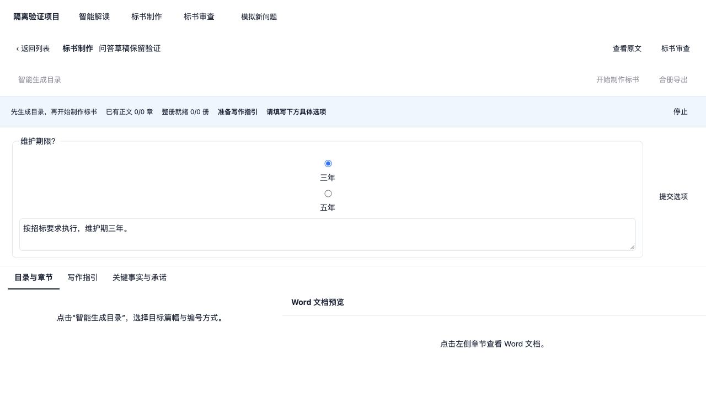

# 标书制作流程验证

验证日期：2026-10-12。

本轮复审修复后的验证通过：40 项 Node 回归、315 项 Python 回归、TypeScript 类型检查和正式构建。待校验发布保护修复后的全量验证命令为 `npm run verify`。

## 页面与操作

- 对照原 bidpilot 的目录生成弹窗与左右布局：恢复目标页数、自定义页数、不限篇幅及编号方式，只保留这两组设置。
- 制作页保留目录与章节、写作指引、关键事实与承诺三个页签。左侧目录约占 40%，右侧显示所选章节 Word；合册后可切换整册预览并下载。
- “开始制作标书”准备缺失或过期的规划，再生成缺失或未完成章节。具体承诺缺值使用页面问答，并在同一会话续接。
- 目录修改保留正文；章节依据变化显示待核对，支持用户明确保留或单独更新。目录改名后的旧正文仍可查看。
- 未保存目录时禁止制作及合册，避免操作使用未保存的目录。

## 验证证据

- 真实 DOCX 的浏览器验证覆盖表格、分页、缩放、章节与整册预览切换。
- 官方 dsh Web HTTP/SSE 回归使用本地确定性模型夹具，实际调用规划、页面问答、正文子任务、DOCX 校验与合册工具；验证同会话回答续接、幂等请求、文件下载、旧正文保留，以及缺少当前目录成果时不能显示完成。
- Python 回归覆盖目标页数限制、编号仅影响合册、正文写入与校验对账、手工修改规划及目录变化。
- 停止执行后卸载、重新加载插件的回归验证停止状态可恢复。停止状态保存于业务动作记录，不再往框架会话写入不支持的自定义事件。
- 本地 3080 服务重启后，进入赣州银行项目的已有目录制作页，核对 25 个正文章节、篇幅与编号弹窗、目录菜单及未保存保护。只修改浏览器草稿验证后丢弃，没有保存或触发真实项目生成。

截图：

- [章节 Word 预览](previews/build-flow/chapter-word.jpg)：隔离验证项目，使用真实 DOCX。
- [目录设置](previews/build-flow/outline-options.jpg)：隔离验证项目。
- [实际服务的目录设置](previews/build-flow/actual-outline-options.jpg)：原有项目，只打开弹窗查看。

## 验证范围

自动化夹具验证执行链路及成果状态，不评价真实模型的业务文案质量。目标页数用于规划和篇幅分配，实际 Word 页数取决于内容及排版。

## 七项整改复核与修复

| 项目 | 最终行为 | 验证 |
|---|---|---|
| 制作完成判定 | 正文及规划齐全后，仍需当前每册合册并发布就绪才能完成；缺册允许继续制作 | 官方 Web HTTP 执行中删除当前整册文件、令模型只结束会话，实际返回 failed；重新导出恢复 ready |
| 分册版本 | 逐册记录目录、正文、共享规划和发布版本；改名/移除旧册作为历史整册保留 | 多册改一册正文只使该册过期；改名需新发布身份；删除发布包和发布失败均不变成 ready；前端历史整册无“下载标书”入口 |
| 重复目录发布 | 设置文件消费后继续继承当前目标篇幅及编号，新设置显式覆盖 | 两次同轮直接发布保留200页/gov；下一次明确不限篇幅/不编号生效 |
| 未保存保护 | 当前页签重复点击不执行离开动作，不清除脏状态 | 真实 NavigationGuard 组件回归；正式浏览器修改草稿、重复点当前页签，制作保持禁用，取消后恢复 |
| 目录阅读布局 | 删除搜索、项目名称/编号、底部编号设置及单册外框标题；直接显示目录，保留编制说明 | 正式项目页面截图，左右目录/Word布局；篇幅与编号仍在生成弹窗 |
| 整体目录编辑 | 对照原bidpilot，行内改标题、删除、更多；添加子项/一级目录、四种排序、升降级、移动到其他父级 | 组件保存请求验证标题、树序、来源、编制说明和设置完整保留；纯树函数拒绝后代/跨册/超过五层移动；浏览器菜单完整展示 |
| 进度与布局 | 删除独立“本轮已结束”栏，执行阶段、正文及整册进度、停止统一在蓝色底栏，待答问题继续展示 | 页面实测；停止和具体选项提交组件回归通过 |

追加截图：

- [正式项目的新布局](previews/build-flow/after-seven-fixes.jpg)
- [正式项目的目录编辑菜单](previews/build-flow/directory-edit-menu.jpg)
- [新布局中的真实Word预览](previews/build-flow/after-seven-word.jpg)：隔离项目DOCX，已验证翻页与切换整册。

没有新增依赖、兼容层或迁移。生成发布与版本核对使用现有产物发布和文件机制。当前历史产物不自动补盖新的制作依据印记，重新合册发布后才标记为当前就绪。

## 三项复审问题：验证设计与修复结果

先增加失败回归，再修改实现。修复前，缺章就绪、部分合册发布、三种册名空白输入及页面切换问答草稿测试均失败；修复后全部通过。

| 问题 | 验证场景与验收条件 | 最终结果 |
|---|---|---|
| 部分合册误报就绪 | 两个必需正文章节只生成一个；部分文件可留在工作区，但不能发布为整册、标记 ready 或成功导出。补齐后重新导出，发布包确实含新增章节 | Python 实际 DOCX 合册、发布、runner 导出验证通过；缺章返回 422，补齐后 ready |
| 旧整册被部分成果覆盖 | 先完成并发布整册，再删除一个必需章节重新合册；旧发布包内容及版本不变，当前整册为 stale | Python 及官方 Web HTTP 验证通过；保留旧文件字节，导出拒绝，恢复后正常合册 |
| 册名规范不一致 | 首尾空格、制表符/换行及空册名；派发、章节依据记录、合册、发布身份、当前册对账及前端章节选择一致 | 共用 body_contract 的册名身份函数；三种 Python 实际合册/导出、前端选择及带空格册名的完整官方 Web 制作链路通过 |
| 问答草稿切换丢失 | 在同一项目选择答案并填写说明，解读→制作→审查→解读仍保留；新问题或新会话清空旧答案 | 草稿由项目详情持有，执行栏使用受控输入；组件回归及真实 React 浏览器交互通过 |
| 未完成章节就绪与发布保护 | 正文已写入但仍为 draft，不能发布新整册或覆盖旧发布包；校验后才能正常发布与导出 | Python 实际 runner 及官方 Web HTTP 回归通过；失败导出保留旧发布包字节、版本及依据印记，校验后发布新正文 |

合册仍允许未生成的模板/附件标为“另附”；必需正文缺失、同名内容未并入或节点误指整册文件时，只保留部分工作文件，不发布新整册。整册就绪还要求必需正文文件存在且没有待校验的写入。旧回归中“缺章也发布”的断言已改为“补齐后才发布”，保留目录顺序、标题样式、附件说明及重复发布的检查。

待校验发布保护追加验证：先补回归，确认修复前首次导出会创建待校验发布包、已有整册会被覆盖并递增版本；修复后在发布前检查本册实际并入章节的待校验记录，工作区合册仍保留，返回具体待校验章节。覆盖首次发布、旧发布包保护、校验后恢复，以及两册同名章节只阻止待校验册的场景。官方 Web 夹具实际执行正文修订并跳过校验，HTTP 导出返回 422 且下载字节及版本不变；调用实际章节校验后重新导出，新正文进入发布包、版本仅递增一次。

测试位置：

- `business/python/tests/test_build_state.py`：缺章/待校验就绪与发布保护、真实导出恢复、旧发布包及依据印记保留、分册隔离、册名一致性。
- `business/python/tests/test_docx_ops.py`：缺章部分文件保留，补齐后发布及重复发布不增版本。
- `tests/workflow-repairs.test.mjs`：问答跨页面重挂保留、新问题/新会话清空、册名章节选择匹配。
- `tests/plugin-lifecycle.test.mjs`：官方 Web HTTP/SSE 制作、带空格册名、缺章及待校验导出 422、旧发布包保留及实际校验后恢复。

浏览器截图为隔离项目，使用实际 ProjectWorkbench、ExecutionControls 和 React 组件，接口返回确定性验证数据；未修改真实项目或发起真实模型生成。问答草稿按项目详情生命周期保留，浏览器刷新或退出项目不持久化草稿。

