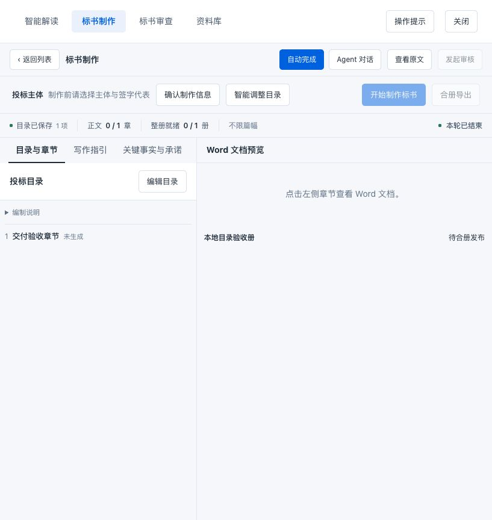

# 0.1.7 目录执行验收

日期：2026-10-19。本文记录目录执行与原生会话恢复的增量修复及最终代码验证。最终安装包与公开下载入口的验证结果、文件哈希以同一 GitHub Release 的 `validation.json` 和 `SHA256SUMS.txt` 为准；正式环境由用户自行安装。

插件版本 **0.1.7** 与宿主版本 **DeepSeek Harness 0.2.1-rc.2** 独立编号。本次继续只支持该宿主版本，不增加旧接口兼容层、数据库迁移或旧版回退；业务功能、数据结构和存放位置保持。模型回复中的版本描述不能用来确认宿主版本，也不能据此断定存在宿主版本故障。宿主契约应以安装声明和实际加载版本核验。

## 原始错误与入口契约

目录阶段必须先通过页面动作或原生 `ooo_bidpliot_run(kind=outline)` 建立本轮派发及汇总契约，再执行 `outline_plan`、目录校验和发布。旧会话直接调用底层目录工具，不能替代阶段入口。

| 原始现象 | 实际含义 |
| --- | --- |
| 422：`本轮目录契约尚未启动，请从目录阶段开始` | 本轮目录入口尚未建立契约，底层工具拒绝执行。此错误本身不证明客户端版本不匹配。 |
| 409：`当前执行尚未结束` | 冷恢复后的旧动作被当前新轮 Agent 的运行状态误判为仍在执行，阻止显式的新阶段请求。 |
| 同轮第二次 `run` 持续等待，停止也无法及时收尾 | 第二次调用等待当前 Agent 自己停轮，而当前轮又在等待该工具返回，形成自等待。 |

13:37 的记录仅能说明用户手动重新发起了执行；不能据此推断旧动作自动恢复、原动作续跑成功或升级完成。本文不收录客户项目名称、编号、材料正文、模型凭据或私有诊断。

## 实现范围

- **同轮重入防护**：当前 Agent 仍持有正在等待停轮的动作时，阶段与完整流程的重复 `run` 立即返回 409，并提示先完成当前阶段、结束本轮。拒绝发生在等待旧动作或启动完整流程之前。当前轮自然结束后，新轮可正常进入。
- **冷恢复执行归属**：用动作编号和 Agent 的实际执行归属判断活动状态。没有活动归属且没有结束边界的旧动作保持中断失败；后续轮次的运行或完成不能被归入该旧动作。真实待答问题沿用问答状态，不能一律按失败清除。
- **正常新轮与保存竞态**：自然停轮时先冻结旧轮事件边界，再完成会话保存和动作结算。新轮在必要位置等待这段已停轮的保存，避免误报重入、把旧动作重新标为运行中或由旧保存覆盖新动作。
- **原生问答首步接管**：根据本次原生答复及真实问题标识，在恢复首步重新接管原动作并记录当前轮边界。答复仍在原会话继续，不另建项目或主会话。

冷恢复的有效上游复用以正常完成证据和当前输入版本为准。仅存在八份文件，不足以把一次尚未完成的解读视为成功；本次冷恢复用例先正常完成解读，再中断下一轮目录。

## 已取得的定向证据

这些结果对应修复过程中的专项运行，不替代最终代码的完整门禁。

| 专项 | 旧实现证据 | 修复版定向结果 |
| --- | --- | --- |
| 同轮阶段及完整流程重入 | 隔离 Web 中第二次调用自等待；原生停止不能完成收尾 | `chat-run-reentry.test.mjs` 1/1 通过，8.11 秒。真实工具回执返回冲突，原始错误状态为 409；两次拒绝均小于 2 秒。 |
| 冷恢复后的原生新轮目录 | 用保存的旧候选源码置换独立临时测试副本，真实工具回执返回 `当前执行尚未结束`；1/1 按预期失败，14.59 秒 | `chat-run-cold-recovery.test.mjs` 1/1 通过，15.67 秒。强制退出后原会话新轮建立目录契约并完成校验发布。 |
| 正常停轮保存与新轮交接 | 定向回归控制真实会话保存时序，检查旧轮边界与新轮进入 | `chat-run-settlement.test.mjs` 中两种真实时序与最终联合回归均通过。 |
| 原生问题答复首步接管 | 根据真实答复消息和问题标识接管原动作 | 提问保存竞态、连续两次答复与答复后原生停止专项均通过；包含在最终191项回归中。 |

同轮重入测试必须收到真实 `tool/result`，超时会使测试失败。它同时核对动作文件、锁、提交占用及自动流程任务未变化；原轮无需停止或取消即可自然完成，随后同一会话的新轮正常发布目录。

冷恢复测试运行两个真实官方 Web 宿主进程，使用独立应用目录、同一临时 profile 和本机确定性模型。第一阶段正常完成解读；第二轮原生目录取得契约并保存草稿后保持流式执行，再以 SIGKILL 终止进程，不调用正常卸载清理。重启只打开原会话，确认模型请求为零；用户显式发起新轮后，模型调用原生 `run`，读取旧草稿，建立当前契约，再校验发布，未借页面动作绕过入口。

旧候选红例只替换临时测试副本中的运行时与原生对话工具源码，工作区产品文件的运行前后 SHA-256 一致。未改写旧会话事件，也未合成完成事件使测试通过。

## 数据与历史保全

目录冷恢复专项逐项比较八份已完成解读与目录草稿的 SHA-256，重启打开和显式续跑后均保持一致；新轮先读已有草稿，未调用写入工具盲目重写。原生会话的完整持久事件前缀逐事件保持，三次动作仍属于同一主会话。正常完成的解读继续保持完成；原先崩溃的目录动作在后续发布成功后仍为失败，不被追认成功。

原件、其他成果及数据库保全还由[整插件异常卸载验收](P2-UNLOAD-017-ACCEPTANCE.md)覆盖：原件与成果按字节核验；正常重新启用后的 SQLite 按 schema、版本及所有表的类型化值比较，包含 BLOB。历史专项结果只证明其对应快照，最终交付仍须按最终代码复验。

本次目录修复只在隔离 dsh Web 环境实施和验证，不操作正式插件、正式数据或生产服务，不自动重发实际客户目录任务。

## 验收边界与最终门禁

本机确定性模型用于稳定验证工具入口、调度、问答、事件边界和数据保留，不代表真实模型生成质量。真实模型请求超时只能说明该次模型请求未完成，不能单独证明工程逻辑失效，也不能当作工程链路已通过；应分别检查工具回执、动作状态与已持久化成果。等待时间耗尽不作为测试成功条件。

### 审核回归的 UTF-8 分块读取修复

完整回归中，审核夹具把原文“文件按资格文件、技术文件、报价文件三个部分组织。”读成“文件按资格��件、技术文件、报价文件三个部分组织。”，随后条款匹配断言失败，外层才显示 `Connection error`。捕获的引用仍是 `tender-0` 第7行；直接读取该行及文件哈希表明解析稿未损坏。

根因是本地模型 HTTP 服务用 `raw += chunk` 逐块隐式解码 UTF-8 字节。中文字符跨分块时会变成替换字符。夹具已统一使用 Node 内置的 `node:stream/consumers.json`；生产请求读取及业务子进程采集原本先合并字节再解码，此项不修改产品或数据格式。

新增验证直接向同一模型服务端发送请求，在首块确实被接收后才发送其余字节，分别拆开中文的两个字节边界及 emoji 的三个字节边界。旧读取方式在第一个边界稳定失败；修复后五种边界和完整审核专项均通过（38.43秒）。保留全部条目、引用、问题数、停止与冷恢复断言；最终联合回归结果另行记录。

最终代码的验证结果：

| 门禁 | 结果 |
| --- | --- |
| TypeScript 检查与构建 | 通过 |
| 完整 JavaScript 串行回归 | 191/191通过，0失败、0取消、0跳过，645.22秒 |
| 完整 Python 业务回归 | 661项通过，56.12秒；其后未改动产品代码 |
| 独立交付、卸载、原位更新与数据保全 | 23/23项通过 |
| 审核 HTTP 分块回归与全链路 | 最终联合回归中通过，39.10秒；含5种强制字节拆分 |
| 独立 dsh Web 页面操作与冷重启 | 下节保留实际操作截图及逐文件核验说明 |
| 最终 TGZ/ZIP、同包 Web 安装、公开下载入口 | 对应 Release 的 `validation.json` 记录实际结果与全部安装源文件哈希 |

191项覆盖整插件保存失败清理、同轮重入、冷恢复、新轮保存交接、原生问答和完整业务流程。最终交付使用重新生成的安装包，不复用旧候选包；公开发布与正式安装分别记录，发布不能视为已更新生产环境。

本文件与 `docs/P2-UNLOAD-017-ACCEPTANCE.md` 已加入 `package.json` 的 `files` 清单，最终安装包仍须实际检查。客户材料、凭据、业务数据及私有诊断不进入交付包。

安装验证使用 README 中公开说明的 `PNPM_CONFIG_SIDE_EFFECTS_CACHE=false`。pnpm 11.25.0 对同一 TGZ 的构建缓存会遗漏 Python 虚拟环境解释器链接；仅在本次安装进程中关闭构建结果缓存，确保实际安装位置执行已批准的 `postinstall`。此项不修改全局缓存、正式 profile 或产品代码。安装与冷重启后的完整保全比较采用同为已关闭的宿主状态，运行时进程占用标记仍在完整文件比较中，不排除或隐藏遗留标记。

会话保全同时核验每个会话文件的原始物理字节前缀、官方持久化后端解码的完整旧事件与会话头。SDK 恢复会话会追加正常的 `session/end-seed`；仅允许空数据的该标记追加，禁止新增模型、工具或业务轮次，禁止替换旧事件。原件、业务文件、完整 SQLite 和附件仍按内容完全相同核验。

## 隔离 Web 页面证据

3081 中实际操作确认：同轮重复入口约3秒返回真实冲突并自然结束；新轮目录建立契约并保存1项，6个工具回执均成功。15份原件、解读和解析成果逐文件哈希保持一致。加载最终运行时源码并冷重启后，原项目、目录和9轮会话保留，没有自动启动业务。

[重复入口实际回执](evidence/directory-017-reentry-web-20261019.jpg)。截图中“待合册发布”指正文整册，目录状态以顶部“目录已保存”判断；此项目的目录验收没有继续生成正文。
