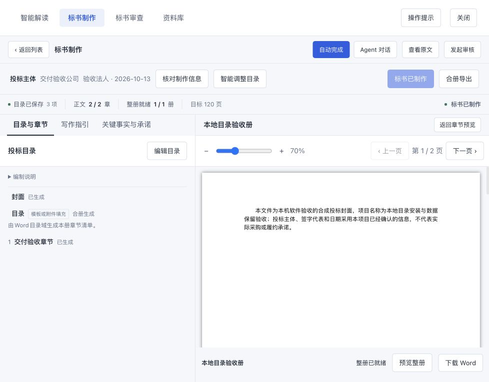

# DSH rc.3 适配验收

日期：2026-10-27。结论：取消精确宿主版本限制的三处修改已完成，当前 `0.2.1-rc.3` 的全部工程与隔离端到端验收通过。

## 最终契约

| 位置 | 最终行为 |
| --- | --- |
| package.json engines.dsh | `>=0.2.1-rc.3 <0.3.0-0` |
| 所有 DSH peer | 与 engines.dsh 相同的范围；包括 CLI、客户端、模型、scope、子任务、工具和压缩组件 |
| server/installation.mjs doctor | 使用 semver 的范围判断，`includePrerelease: true`，与官方门禁相同；不再比较字符串是否相等 |
| 开发 SDK | 固定为 rc.3，锁文件同步更新；296 个 DSH SDK 包均核对为 rc.3 |

上界写成 `<0.3.0-0`，使下一系列的候选版本也被排除；在 includePrerelease 开启时，单写 `<0.3.0` 仍会接受 0.3.0-rc.1。支持范围允许同系列后续更新，不代表所有未来版本均已验收。Cordis 4.0.5、loader 1.0.6 及 React 契约保持原要求。

semver 7.8.5 原已存在于依赖树，现声明为 doctor 的直接运行依赖。未增加旧宿主适配层、版本豁免或运行时补丁。

## 验收结果

| 检查 | 结果 | 证据 |
| --- | --- | --- |
| TypeScript 类型检查 | 通过 | `npm run check` 退出 0 |
| 正式构建及本地 PDF 资源 | 通过 | `build-rc3.log` |
| Node 全量回归 | 261 通过，0 失败、0 跳过 | `node-rc3.log` |
| Python 全量回归 | 862 通过 | `business-rc3.log` |
| 版本门禁与隔离定向回归 | 18 通过 | `version-gate-rc3.log` |
| 干净目录完整交付生命周期 | 23 阶段通过 | `delivery-rc3.json` |
| 已安装 App 的真实 ASAR：目录安装 | 9 阶段通过 | `desktop-link-rc3.json` |
| 已安装 App 的真实 ASAR：最终候选压缩包安装 | 9 阶段通过 | `desktop-package-final-rc3.json` |
| 浏览器实际界面 | 6 项检查通过，控制台无 error | `browser-rc3.json`、`rc3-word-preview.jpg`、`rc3-native-chat.txt` |

证据均位于项目 `outputs/dsh-upstream-audit-20261027/`。定向回归包含于全量回归，不重复累计测试数。

真实桌面宿主版本为 DSH 0.2.1-rc.3、Cordis 4.0.5、loader 1.0.6、Electron 44.7.0、Node.js 24.21.0；Web CLI 与全量 Node 回归使用 npm 官方 rc.3 SDK、Node.js 24.15.0。Python 为 3.13.13，系统为 macOS arm64。

## 门禁边界

以下每一行都同时检查 doctor、官方 engines 门禁，以及去掉 engines 后的官方 peer 门禁；三个判断一致。

| 宿主版本 | 结果 |
| --- | --- |
| 0.2.1-rc.3 | 接受 |
| 0.2.1-rc.4 | 接受 |
| 0.2.1 | 接受 |
| 0.2.2 | 接受 |
| 0.2.1-rc.2 | 拒绝 |
| 0.3.0-rc.1 | 拒绝 |
| 0.3.0 | 拒绝 |

rc.4、0.2.1 和 0.2.2 在此表中是门禁的版本输入，未将它们写成已经进行运行验收的发布版本。

## 端到端覆盖

- 通过官方 CLI 在全新目录中安装依赖、准备 Python、构建并安装插件；实际压缩包另通过已安装 App 自带的 CLI 安装到独立 profile。
- 完成真实工具链的文件上传、图片转写、招标解读、目录、写作指引、事实承诺、正文、定向修订、Word 合册与下载。
- 全量回归覆盖解读→目录→制作→审查、缺值暂停与原生回答、同一主会话继续，以及审查证据和报告保存。
- 覆盖自动压缩、上下文超限恢复、主子任务隔离、子任务取消、尾事件落盘、历史只读保留、写后强制退出及冷恢复。
- 覆盖活动宿主拒绝原位更新、更新失败回滚、成功更新、卸载、重装；检查数据库、业务文件、宿主会话和附件保留；冷恢复后重新读取成果并下载，普通宿主 Agent 能继续运行。
- 缺构建资源、Node 依赖、Python 环境或 Python 模块时明确拒绝激活；错误宿主范围被拒绝，拒绝检查不改变已有数据。
- 真实 App 运行时的官方组件均解析到 App ASAR，候选发行包不携带第二份 DSH 核心；公开业务预设唯一，动态组件全部激活。
- 浏览器确认侧栏入口、项目列表、解读与原件图、正文 2/2 和整册 1/1 的状态、修订后的 Word 整册预览及下载入口；从工作台进入宿主原生对话，可见历史、子智能体入口和可编辑输入框。

## 验收中修正的旧夹具

首次交付验收在定向修订时失败：夹具把“封面”和“交付验收章节”一起选中，却只修订、校验后一章。当前业务正确拒绝“封面未通过本轮校验”。

修正 `tests/helpers/delivery-host.mjs` 的业务场景，只将实际要修订的“交付验收章节”传入；保留业务完整性检查。重新执行完整 23 阶段交付验收后全部通过。首次失败记录保留在 `delivery-rc3-initial.json` 与对应日志，未将其覆盖为通过。

## 交付范围

本次适配与验收对象是当前工作区的 `ooo-bidpliot@0.1.6` 候选构建；候选压缩包在 `outputs/dsh-upstream-audit-20261027/package-final/`，尚未发布。当前桌面已安装的 `0.1.10` 发行包没有被本次隔离验收替换，Office 插件的独立声明也没有修改。

模型响应采用本机确定性夹具，实际运行的是官方宿主、Agent 循环、工具、Python 业务及文件服务。本次结论覆盖工程兼容与业务链路，不包含外部真实模型的生成内容质量评价。临时浏览器与验收宿主均已关闭。

