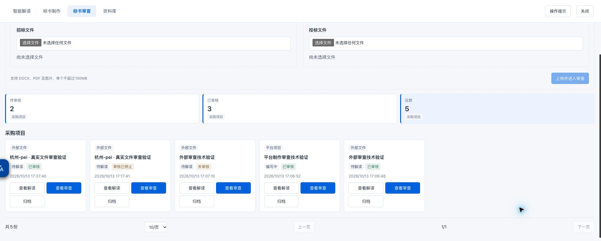
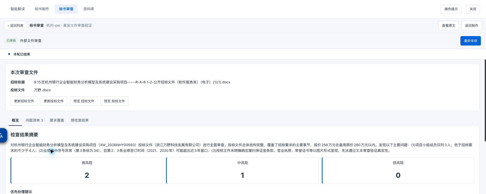

# 标书审查真实数据验证

结论：真实报告已产出并在页面展示，技术链路通过；审查质量验收未通过。候选实现仍在隔离工作树 `codex/bid-review-verification`，未合入主工作区或部署正式3080宿主。

## 按钮排版

智能解读、标书制作、标书审查的项目卡片使用相同的操作网格、间距、圆角和按钮高度，文字不再折为两行。卡片宽度不足以容纳三个按钮时，按制作栏既有规则分为两行。已在真实项目列表中检查。

## 真实输入和模型

从灵燕「杭州-pei」工作区只读取得原件，以HTTP上传到隔离候选环境：招标DOCX约1.22MB，投标DOCX「万野」约20.96MB。两份文件重新使用现有解析器解析，分别得到1499行和1199行。原件及上传副本的SHA256在执行前后相同。未把投标文件混入招标解读来源。

模型为用户当前配置的本地 `lmstudio / mlx-community/Qwen3.8-27B-4bit`，请求实际转发到 `localhost:8000`。没有使用确定性模型夹具替代本轮回答，没有手工补写模型报告。报告完整原文和官方执行事件保留在隔离环境忽略目录 `data/`；受版本控制的证据只保存技术元数据。

## 验证中发现并修复的问题

1. 首轮实际模型报上下文超限：108209输入令牌加32768输出预算超过131072窗口。审查改用独立工具集合，并在现有dsh模型信息中预留明确输出预算，复用官方裁剪逻辑。
2. 第二轮模型生成的JSON字符串和“原文摘录”多次不合法。取消字符串化报告接口，直接接收结构化对象；证据只接受文件标识与起止行号，程序从原文提取摘录。没有添加JSON修复或摘录降级处理。
3. 外部真实性无法由文字证明，不能强迫模型为未知事项编造投标依据。未知事项允许无投标证据并列入核查限制；已响应、冲突仍必须有投标证据，缺失、冲突必须关联问题。
4. 同版本失败或停止后重试，使用官方会话种子继承读取记录和草稿，保留独立新会话及原失败轨迹。版本变化不继承。

## 实际产出与质量判断

第三轮重试调用实际模型23次，模型请求累计31.92分钟；最终保存18条要求、3项风险、六类覆盖声明及限制说明。36条摘录全部逐字匹配程序指定的原文行区间。官方执行完成后状态为已审核，页面概览、问题清单、双方证据及复核备注均可操作。

这次成功继承了先前失败会话，不是独立首次执行成功率验证。前两轮失败和32分钟重试耗时说明当前稳定性、延迟仍不能作为上线通过依据。

先于最终报告记录的人工验收判据要求识别人员3人与不少于4人的差异、2021/2020年业绩超出评分起点，并检查全文响应以避免工期、交付文档、培训的误报。模型识别到了两项重点，未断言整份标书缺少上述工期、文档、培训，也将图片证照及签章列为待人工确认。

质量仍不通过，具体证据如下：

| 要求 | 实际缺陷 |
| --- | --- |
| R20 业绩评分 | 引用招标L260材料清单，未引用L1056明确的2023年1月1日起评分窗口；仍写“若要求近3年”，且高风险定级需要复核。 |
| R22 业务方案 | 标为已响应，但投标L457–458只给出交付工期，无法支撑完整业务方案已响应的结论。 |
| R11 资格承诺 | 招标L58是财务、税收、社保要求，投标L87–88是分包及关联单位承诺，双方证据未对齐同一要求。 |
| R38 软件适配 | 招标L1422–1424只有标题和表头，不能支撑完整的软件及版本适配判断。 |

因此，摘录真实不等于证据足以支撑判断，声明六类覆盖也不等于完整覆盖。业绩问题的复核备注已通过页面保存，原模型报告保持原样，未人工改成通过。

“已审核”在当前产品契约中表示报告执行完成，并不表示判断通过人工验收或投标合规。

## 回归及验证边界

- TypeScript检查、生产构建通过；Node全量121项、Python全量461项通过。
- 最新引用契约的官方宿主端到端夹具10项通过，覆盖两种入口、输入版本、失败、停止、伪造证据、禁止改写正文、人工复核和恢复。
- 本轮真实文件只验证外部数字DOCX。平台制作入口仍是工程夹具结果，未用另一个真实项目验证模型审查质量。
- DOCX内嵌图片尚未逐图核验；PDF和扫描件未新增真实审查全链路验证。
- Chrome自动文件选择受扩展本地文件权限限制；没有修改权限。真实HTTP上传与字节一致性已经验证，用户文件选择交互仍需人工补验。

证据：

- [实际模型及执行元数据](evidence/review-real-20261013.json)
- [预先记录的人工判据](evidence/review-real-acceptance-criteria-20261013.json)
- [质量验收结果](evidence/review-real-quality-validation-20261013.json)
- [上下文超限失败](evidence/review-real-first-context-failure-20261013.json)
- [旧摘录契约失败](evidence/review-real-second-quote-failure-20261013.json)
- [最新契约夹具](evidence/review-source-ref-fixture-20261013.json)
- [实际双方证据和复核备注](evidence/review-real-evidence-20261013.jpg)
- [Node回归日志](evidence/review-final-node-20261013.log)
- [Python回归日志](evidence/review-final-python-20261013.log)

最终构建完成后，恢复了只展示已有数据的本地预览，未重新调用模型；当前入口记录在隔离环境 `data/review-preview.json`。真实模型执行证据中的旧端口保持原执行记录，不代表当前预览端口。

后续修正应针对逐条要求与双方证据的语义对齐、明确的评分时间范围、核查范围遗漏和实际模型延迟，并以独立新会话重新验收。当前证据不支持正式合入上线。
