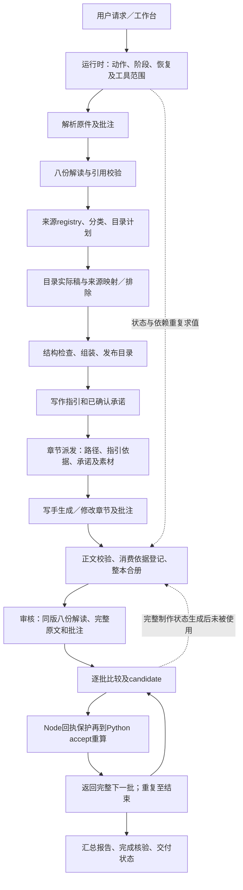

# 当前主代码全项目审计报告

> 清理状态（2026-10-20）：已按用户要求删除本轮及此前相关隔离副本、临时脚本、原始请求／日志、测试标书、原始取证及未合入补丁。仅保留汇总报告与问题清单；标注“已清理”的明细无法再打开，后续验证需重新建立隔离环境。主代码、正式数据、用户原始样本及本地模型服务未操作。

2026年10月20日更新。报告以当前主工作区为审计对象，纳入未提交修改；合并全项目问题、灵燕及DeepSeek Harness源码差异、包3完整链路实测、778条逐请求明细，以及已确认的实施切片。

**最新结论：先保留现有提示词，优先删除不改变模型所见内容的内部重复计算。上一轮 E01＋E02 目录候选虽然减少请求，重点义务承接却从8/8降到2/8，未通过质量验收，不作为后续累计基线。当前主代码未合入该候选。** 此前从当前工作区建立隔离副本，调整 **E03 → E12** 并作包3同值回放；本轮补齐前序阶段，后续按第十三节分别处理目录误失效、制作调度、解读与制作输入，审核E04继续保留。历史／回执／工具范围优化单列，不能因提示词文字没变就免做模型质量验证。

本轮主目录运行源码和业务提示词未改，未部署；调整仅在隔离候选中。只使用已获授权的包3测试资料，没有读取生产业务数据、生产配置或灵燕用户工作区。本轮新增的是程序回放，没有新增模型调用，不将它写成完整链路重新生成的结果。原778条Flash记录和后续112条本地模型目录记录保留各自口径。

本报告保留完整问题清单：上一轮新增Q07目录排除适用性，本轮继续补齐解析、解读、目录、正文及合册，新增E17／E18／D09。第十二节保留E03／E12隔离调整结果；前序阶段最新链路、排序和提示词审批边界见第十三节。旧成本观测不是当前已修复状态。

## 一 审计结论和证据强度

“所有复杂度都是合并新增、删除后必然大幅提速”缺乏证据。完整逐要点审核是本工程新增能力；富描述阈值、长文概览、整节回执、渲染轮询及部分编辑问题也来自灵燕。已有目录计划在两组Flash基线中都存在，不能把全部输入增长归为最后一次并发改动。

支持精简的证据更具体：当前源码有逐条模型登记、父子重复处理、未消费的状态结果、同批两次candidate、完成后的全文回读；其中无用状态路径和单章按需版本求值已有等值原型。应该先移除重复工作、复用现有机制，同时保留用户事实、完整证据和质量规则。

| 归类 | 数量 | 含义 |
|---|---:|---|
| 待处理问题、成本项和功能差异 | 41 | 包含源码确认、实际复现及局部原型，逐项注明状态；不是41个新增漏洞 |
| 已有保护和改动 | 10 | 保留已取得的改进，同时标明未解决部分 |
| 暂缓实施的条件项 | 2 | 推理配置、共享自适应配速，缺少本轮直接收益证据 |
| 逐请求记录 | 778 | 修复前344条、修复后434条，均与接口及原生会话唯一匹配 |

P0、P1、P2表示问题严重度和关注层级，**不是依据现有两次运行得出的精确收益排序**。最新执行顺序见第十二节；其他正确性问题独立留在清单中，不夹带进性能版本，不因暂缓就视为解决。

## 二 范围和基线

| 范围 | 已有检查 | 实质边界 |
|---|---|---|
| 解读、目录、制作、审核及Agent编排 | 当前源码、原生调用与包3两组完整Flash记录 | 没有精简后的新全链收益数据 |
| 状态、依赖、停止和恢复 | 版本依据、写手分配、动作回执、取消和恢复测试 | 旧样本版本断言与产品缺陷分别判断 |
| 主体、资料库、素材和版式 | 更换、删除、识别、人工值、检索及冲突测试 | 未读取用户实际资料库 |
| 编辑、上传及路径 | 合成任务真实服务、双进程保存及软链接探针 | 竞态是可复现性，不代表日常发生频率；链接需要本地前提 |
| Word解析、批注、合册和导出 | 终稿视图、批注证据、原生域和引用、已有包3视觉核查 | 原生域有效不等于Office已完成实际分页 |
| 前端、权限和渲染 | 页面状态、工具隔离、只读原件、刷新与队列检查 | 不宣称全部浏览器窗口与崩溃组合均已验证 |
| 构建与交付 | 类型检查、隔离构建、白名单和失败回滚测试 | 未重新联网安装全套依赖或执行部署 |

347个文件指纹证明本次复核对象未变，不等于347份文件各自获得完整语义审查或测试覆盖证明。隔离程序数据目录为空起步，任务及文件由测试创建。模型日志仅使用已授权的包3隔离记录。

灵燕参照为公开v0.2.3，固定源码提交`4545829c6c0a9e799cb82527af64d9e0a05c9364`；DSH参照当前依赖`0.2.1-rc.2`及既有源码分析。未读取灵燕用户工作区或生产配置，也没有同模型、同包3、同资料、同交付范围的灵燕计费实测。因此灵燕对照是实现和功能差异，不能报告其token低多少或速度快多少。

源码指纹、原始日志和逐项状态见[统一问题清单](/Users/ooo/Documents/AIwork/bidv4/docs/evidence/whole-project-audit-20261020/consolidated-issue-catalog.json)、上游源码索引（已清理）、隔离验证汇总（已清理）。

## 三 完整链路与逐请求用量

### 计量口径

- token取接口实际usage。输入包含缓存命中；未缓存输入单列；输出包含推理token。
- 778条请求均通过“输入、输出、缓存命中”组合与唯一原生assistant记录匹配。原生inputTokens不含缓存，匹配时加回cacheReadTokens；没有用相邻时间猜会话。
- 最大工具返回体按最近工具轮的回执UTF-8 JSON字节及文本字符衡量，指本次请求之前的工具结果，不是本响应随后发起的工具。历史留存最大回执另列候选。
- 旧记录没有每次HTTP全文，请求时裁剪和适配不能完全还原；工具回执大小不是工具计费token，历史候选也不是已证明的实际wire消息。
- 同一资料随每轮请求重复发送会重复计入输入。缓存降低部分计算和费用，不使日志输入量归零。
- 未读取账单或适用历史单价，不估算人民币费用。费用需要分别应用缓存输入、未缓存输入和输出的实际单价，不能只按总输入判断花费。

完整附件：[778条逐请求明细表](/Users/ooo/Documents/AIwork/bidv4/outputs/01a15407-5445-74f0-8caa-7d6f0c160bdf/token-request-ledger-20261020/包3逐请求Token明细.xlsx)、[同表CSV](/Users/ooo/Documents/AIwork/bidv4/outputs/01a15407-5445-74f0-8caa-7d6f0c160bdf/token-request-ledger-20261020/包3逐请求Token明细.csv)、[逐请求数据及来源指纹](/Users/ooo/Documents/AIwork/bidv4/outputs/01a15407-5445-74f0-8caa-7d6f0c160bdf/token-request-ledger-20261020/request-ledger.json)、[对账与文件验证](/Users/ooo/Documents/AIwork/bidv4/outputs/01a15407-5445-74f0-8caa-7d6f0c160bdf/token-request-ledger-20261020/validation.json)。

### 两组历史完整链路

以下为已有优先级修复前后的一对隔离运行，不是新实施B0至B3的比较；其来源与源码基线保留于[包3完整验证](/Users/ooo/Documents/AIwork/bidv4/docs/PRIORITY-INTEGRITY-PACKAGE3-2026-10-20.md)。

| 指标 | 历史修复前 | 历史修复后 | 观察 |
|---|---:|---:|---|
| 总耗时 | 2,062.730秒 | 1,888.770秒 | −8.4%，单对运行 |
| 输入token | 26,847,585 | 29,260,603 | ＋9.0% |
| 缓存命中token | 26,129,408 | 28,409,472 | 包含在输入内 |
| 未缓存输入token | 718,177 | 851,131 | ＋18.5% |
| 输出token | 366,535 | 420,391 | 包含推理 |
| 模型请求 | 344 | 434 | ＋90次 |
| 工具调用 | 519 | 627 | ＋108次，包含失败尝试 |
| 原生工具错误 | 18 | 32 | 不含全部业务失败字符串 |
| HTTP错误及输出预算耗尽 | 0／0 | 0／0 | 本对运行不支持它们是主要瓶颈 |
| 正文推理实际峰值 | 1 | 2 | 上限8不等于实际8路 |

### 按阶段的请求及token

| 版本 | 阶段 | 请求数（主／子） | 输入token | 缓存命中 | 未缓存输入 | 输出token |
|---|---|---:|---:|---:|---:|---:|
| 修复前 | 解读 | 33（33／0） | 2,416,892 | 2,353,024 | 63,868 | 43,314 |
| 修复前 | 目录 | 37（37／0） | 2,845,285 | 2,774,784 | 70,501 | 41,699 |
| 修复前 | 整本制作 | 223（25／198） | 13,288,407 | 12,930,048 | 358,359 | 181,182 |
| 修复前 | 审核 | 51（51／0） | 8,297,001 | 8,071,552 | 225,449 | 100,340 |
| 修复后 | 解读 | 30（30／0） | 1,904,981 | 1,846,400 | 58,581 | 31,617 |
| 修复后 | 目录 | 94（49／45） | 5,905,770 | 5,724,800 | 180,970 | 82,098 |
| 修复后 | 整本制作 | 266（33／233） | 14,107,957 | 13,728,256 | 379,701 | 213,120 |
| 修复后 | 审核 | 44（44／0） | 7,341,895 | 7,110,016 | 231,879 | 93,556 |

### 修复后单次输入分布

| 阶段 | 平均输入 | 中位输入 | P95输入 | 最大输入 | 主线程首段均值 | 主线程末段均值 |
|---|---:|---:|---:|---:|---:|---:|
| 解读 | 63,499 | 62,591 | 96,831 | 97,096 | 31,293 | 94,526 |
| 目录 | 62,827 | 56,990 | 122,649 | 128,489 | 46,994 | 116,621 |
| 整本制作 | 53,037 | 49,005 | 88,379 | 137,857 | 48,900 | 108,081 |
| 审核 | 166,861 | 158,040 | 284,057 | 312,054 | 82,260 | 266,371 |

P95是这次请求样本的分位数，不是重复运行耗时的稳定P95。主线程首末段各取该阶段首末ceil(N/4)次请求；子任务单独有自己的历史，不能与主线程混成一条上下文增长曲线。

### 审核后期增长的分段记录

以下只取修复后同一个审核主线程，每段11次请求，避免只展示首末两个点。

| 阶段内请求区间 | 请求数 | 平均输入token | 累计输入token | 未缓存输入token | 输出token |
|---|---:|---:|---:|---:|---:|
| 1至11 | 11 | 82,260 | 904,857 | 93,209 | 11,566 |
| 12至22 | 11 | 132,817 | 1,460,984 | 29,304 | 23,509 |
| 23至33 | 11 | 185,998 | 2,045,977 | 37,273 | 33,931 |
| 34至44 | 11 | 266,371 | 2,930,077 | 72,093 | 24,550 |

### 分阶段耗时与目前能得出的判断

| 阶段 | 修复前秒数 | 修复后秒数 | 变化秒数 |
|---|---:|---:|---:|
| 解读 | 190.052 | 137.271 | -52.781 |
| 目录 | 183.799 | 372.045 | +188.246 |
| 整本制作 | 1,138.368 | 879.836 | -258.532 |
| 审核 | 547.618 | 497.567 | -50.051 |

1. **目录主要表现为请求增加。** 37→94次，平均单次输入约76,900→62,827；累计输入仍增加3,060,485。新增57次包括主线程多12次和子任务45次。这支持优先验证E01／E02，但不能将45次全部当作可删除请求。
2. **制作累计用量最大。** 修复后266次请求、输入14,107,957，占该组输入48.21%；未缓存输入占44.61%，输出占50.70%。并发缩短了本对运行的正文时间，但没有自动降低调用和用量。
3. **审核单次输入最大且阶段内增长明显。** 修复后平均166,861，P95约284,057；首末单次18,638→312,054。请求由51降为44时，累计输入下降955,106，但未缓存输入仍由225,449增至231,879。总输入减少不能直接当作费用同比减少。
4. **本地等待是另一条成本线。** E03／E04、Python短进程、状态计算和长锁主要先影响工具等待。不能因为它们慢，就假定删掉后会减少相同幅度的模型token。

这些是两次既有完整运行内部的逐请求观察，能缩小假设范围，仍不是各代码改动的因果节省量。对称分解“请求数×平均输入”的观测变化也只作描述，不当作E01或E07的收益预测。

## 四 测试结果与质量现状

### 全项目回归

| 检查 | 原始结果 | 说明 |
|---|---|---|
| 类型检查 | 通过 | 当前程序隔离副本 |
| 构建 | 通过 | 审计副本初次漏CSS资源，补齐后原样通过；初次失败保留，不记产品缺陷 |
| Python业务测试 | 735通过，0失败，76.35秒 | 工程测试，不是人工语义质量评分 |
| 前端及原生集成 | 215通过，8失败，共223项，117.20秒 | 原始失败不被后续诊断复跑覆盖 |
| 相关8项诊断集 | 7通过，1失败 | 隔离测试输入适配后；剩余是路径登记问题 |
| 规范路径单章对照 | 通过，13组断言 | 未改产品代码，原短正文保留，未调用模型 |

隔离测试限制网络，仅允许本轮自行启动的测试服务；一次npm注册表访问被拦截并记录，不据此给产品定性。原始日志、诊断测试输入及原文件指纹均可回查。

### 八项失败的归因

| 数量 | 原始失败 | 归因及建议 |
|---|---|---|
| 5 | 对话完整、页面自动、人工目录、页面分步、审核接续 | 共用夹具没有实际章节名，被写手边界正确拒绝。用合法章节名后相关流程通过；更新夹具并保留非法派发反例 |
| 1 | 插件生命周期取消测试 | 取消夹具同样未点名章节，子任务未启动导致等待超时。合法输入后生命周期测试通过 |
| 1 | 0.2.0恢复样本 | 仍要求旧准备版本为ready，当前实际stale，后续恢复断言未执行。用当前格式重建恢复基线，不加migration或兼容层 |
| 1 | 单章准备／恢复 | 工具规范化后校验通过，完成登记仍使用原始反斜杠路径，见D08。仅改为规范路径的对照通过，不代表产品缺陷已修 |

### 成稿和审核质量

两组均有24节ready；各自解读目录覆盖和逐字证据检查通过，引用逐字检查无错误。后组37条Word批注全文完整保留一次，改善了早前漏证据问题。声明父节点正文、无分值项目分类和浮动定位也已有具体修复。

仍需保留的问题包括：成本方法／未来安排被误当事实，条款适用与实际风险触发混用，页眉页脚等非正文证据不足，窄列长表与签章布局，以及完成登记与版本误失效。逐字引用通过并不能证明所有语义结论正确；ready、页数和图片数也不等同交付质量。

已授权人工文档可作写作与版式参照，但没有同条件、同范围的盲评数据，不能宣称总体质量已达到人工或灵燕水平。缺失报价、证明和未确认承诺继续留批注，不虚构；生产成果不参加对照。

## 五 灵燕与DeepSeek Harness的架构差异

| 能力 | 灵燕参照 | 当前主代码及判断 |
|---|---|---|
| 目录制作 | 骨架、单册主线程或多册分稿、R2与三道清理、组装 | 额外增加逐条计划台账、冻结及父子重复处理；这部分是本工程新增协议，列E01／E02 |
| 完整逐要点审核 | 该版本无同等整链能力 | 是合理新增功能；重复candidate、状态与完成编译应在本工程内精简 |
| Agent框架 | DeepAgents／LangGraph及自身中间件 | 当前使用官方DSH，不能直接搬上游状态文件或同时保留两套推理引擎 |
| 工具范围 | 24个显式业务工具，另有框架工具；写手有最小集 | 当前解读／制作主线程48个总schema；两种计数不能说成两倍，能减的是阶段无关schema |
| 并发和写锁 | 本地有界配速及按文件锁 | 当前正文task已可并发，但项目长锁仍限制独立章节；上限8与峰值2分列 |
| 上下文 | 上游已有摘要机制、路径及派发上下文 | 当前已有阶段归档，但内部长程序指令标human、审核阶段内历史积累仍存在 |
| 文档工具 | 已有截断概览、插入后整节回执及渲染轮询 | 属于继承后仍需改善的行为，不全部归为本次合并新增 |
| 编辑、模板和抓取 | 存在相同CAS窗口、修订时间戳、模板链接及非流式抓取模式 | 上游也有不等于可以保留缺陷；复用现有锁、包含校验和httpx能力即可 |
| 恢复入口 | 有工作文件和产物restore接口 | 当前保留恢复点但缺相应产品入口，列M01；产品取舍与缺陷严重度分开 |

DSH已有tools.restrict、isConcurrencySafe、工具执行钩子、agent/pre-step、动态系统上下文、原生子任务及会话持久化，可控制阶段工具、历史生命周期、任务并发、写权限与取消。优先复用这些入口，不为每项问题再造一个Agent或新的管理层。

源码中的并发声明决定工具能否重叠，子任务也有数量和深度限制；只增槽位不能保证吞吐。推理强度须以适配器实际生效参数为准。已有两组无429及预算耗尽，当前没有充分证据先加共享AIMD、改预算或新建常驻worker。

## 六 全量待处理问题

每项同时列当前证据、灵燕差异、建议理由与验收要求。原型通过仅证明局部机制，不表示产品已修；验收要求是将来应通过的条件。具体状态沿用统一清单，避免把待验证方案写成成果。

### 编排和输入

#### E01 目录镜像台账与逐条模型登记

最新复核：本地隔离候选未通过质量，当前主代码保留；不再按原第一片方案继续，见第十二节。

严重度P1，状态：源码及完整链确认。实施归属：第一片。

- **当前证据：**成品目录之外，模型还逐条维护独立计划。包3两组94／83次计划工具调用，其中89／72次成功登记；并非都是错误重试
- **灵燕差异：**新增协议：灵燕目录技能直接完成R2与三道清理，再组装；没有当前outline_plan逐条镜像台账。
- **建议与原因：**从实际目录及来源标注生成机械登记，必要语义判断由同一负责人一次提交；取消镜像台账的逐条模型协议。目录内容与登记来自同一实际结果，减少第二份真值及每条模型往返；保留一次分类判断，避免机械去重丢义务。
- **验收与边界：**固定源、必需分类、独立附件、人工目录和发布一致性反例全部通过，再比真实请求。

代码入口：[business/python/app/services/outline_contract.py](/Users/ooo/Documents/AIwork/bidv4/business/python/app/services/outline_contract.py)、[business/python/app/tools/outline.py](/Users/ooo/Documents/AIwork/bidv4/business/python/app/tools/outline.py)。上游对应或相近能力源码：sidecar/app/skills/tender-outline/SKILL.md（已清理）。

#### E02 单册主子线程重复承担目录工作

最新复核：本地隔离候选未通过质量，当前主代码保留；包3本地基线并未派目录子任务，不能把历史Flash子任务量当作本次成本，见第十二节。

严重度P1，状态：完整链确认。实施归属：第一片。

- **当前证据：**单册也走主线程、子任务、主线程再次处理。后组目录49次主请求、45次子请求；本例无SCORE和必审分类片段
- **灵燕差异：**上游已有子写手，但单册主要主线程、多册才分册；当前单册仍两次派同册，再由父线程复核登记。
- **建议与原因：**单册一个负责人，多册各册一个负责人；检查在提交时返回，机械合并已检查分稿。一个内容负责人能在保留检查的同时消除父子重复读取和转写，提交时修小错不必重启整册。
- **验收与边界：**单册无重复负责人，多册各自限域，分稿机械合并与质量检查一致。

代码入口：[server/native/tools.mjs](/Users/ooo/Documents/AIwork/bidv4/server/native/tools.mjs)、[server/native/execution-guard.mjs](/Users/ooo/Documents/AIwork/bidv4/server/native/execution-guard.mjs)。上游对应或相近能力源码：sidecar/app/skills/tender-outline/SKILL.md（已清理）。

#### E03 审核内部计算未使用的制作状态

严重度P1，最新状态：隔离调整及包3同值回放通过，主代码未合入。当前执行优先级A1，见第十二节。

- **当前证据：**审核批次只使用目录和版本，却递归计算并丢弃完整previous_flow
- **灵燕差异：**新增审核内部计算：该灵燕版本没有相同逐批审核及previous_flow目录包装。
- **建议与原因：**拆开未使用的状态路径。隔离同值原型：数据库连接2284→32，返回结果完全相同；优先删除空计算，不追加全局缓存。调用结果未被消费，直接移除比缓存更简单，消除递归数据库和文档访问而不减证据。
- **验收与边界：**批次内容、分组及版本完全相同；复测数据库次数和工具耗时。

代码入口：[business/python/app/services/review_method.py](/Users/ooo/Documents/AIwork/bidv4/business/python/app/services/review_method.py)、[business/python/app/services/review_batches.py](/Users/ooo/Documents/AIwork/bidv4/business/python/app/services/review_batches.py)。上游对应或相近能力源码：sidecar/app/agent.py（已清理）。

#### E04 审核保存重复校验与Python往返

严重度P1，状态：同值回放确认。实施归属：第二片。

- **当前证据：**保存审核批次先构造candidate，再开第二个Python执行accept并重算candidate；同值回放约6.61秒、4次previous_flow
- **灵燕差异：**新增审核协议：上游无同等candidate→Node→accept二次runner链。
- **建议与原因：**一次工具执行完成校验、版本复核、提交与返回下一批；全部原有规则保留。同规则重复执行不是第二重独立判断；合并事务还能减少候选与接收间版本变化窗口。
- **验收与边界：**全部旧拒绝反例仍拒绝，重复提交和提交前源变化测试通过。

代码入口：[business/python/app/services/review_batches.py](/Users/ooo/Documents/AIwork/bidv4/business/python/app/services/review_batches.py)、[server/native/tools.mjs](/Users/ooo/Documents/AIwork/bidv4/server/native/tools.mjs)。上游对应或相近能力源码：sidecar/app/agent.py（已清理）。

#### E05 审核结束重复编译报告

严重度P1，状态：源码路径确认。实施归属：本批性能切片不改，继续跟踪。

- **当前证据：**finalize、runner完成处理、Agent收尾重复编译和核验报告
- **灵燕差异：**新增审核收尾：上游无相同finalize、runner、Agent收尾三处报告处理。
- **建议与原因：**一次完整门禁提交报告，收尾引用提交回执；冷恢复及实际版本变化仍核验。成功提交是唯一完成依据，减少同版重复编译；恢复时仍核验避免陈旧报告被复用。
- **验收与边界：**正常完成只提交一次，崩溃在提交前后均能正确恢复且不重复生成。

代码入口：[business/python/app/services/review_batches.py](/Users/ooo/Documents/AIwork/bidv4/business/python/app/services/review_batches.py)、[server/native/runtime.mjs](/Users/ooo/Documents/AIwork/bidv4/server/native/runtime.mjs)。上游对应或相近能力源码：sidecar/app/agent.py（已清理）。

#### E06 程序指令被当作真实用户历史

最新复核：当前执行优先级提高为输入优化B1；文字不改仍会改变消息组织，须单独质量验证。

严重度P1，状态：原生消息确认。实施归属：本批性能切片不改，继续跟踪。

- **当前证据：**四阶段程序指令以human消息保存，合计10,233字符随之后请求反复携带；子任务路径上下文也重复注入
- **灵燕差异：**上游也有任务描述和路径罗盘；当前四阶段额外长指令被标human，压缩按用户原话永久保留，子路径又注入两处。
- **建议与原因：**程序指令保持一个当前阶段版本；真实用户原话、已确认事实独立完整保留；复用官方系统上下文。来源区分后可保留真正用户确认，删除旧程序命令；减少重复及旧阶段干扰，无需摘要Agent。
- **验收与边界：**真实用户消息和确认值逐字保留，冷恢复可查旧指令，当前规则只注入一次。

代码入口：[server/native/runtime.mjs](/Users/ooo/Documents/AIwork/bidv4/server/native/runtime.mjs)、[server/agent.mjs](/Users/ooo/Documents/AIwork/bidv4/server/agent.mjs)。上游对应或相近能力源码：sidecar/app/agent.py（已清理）。

#### E07 审核阶段内历史持续累积

最新复核：当前执行优先级提高为输入优化B2；旧“暂只观测”顺序由第十二节替代。

严重度P1，状态：历史实测及框架原型通过。实施归属：本批性能切片不改，继续跟踪。

- **当前证据：**审核阶段内部历史持续增长，后组单次请求输入18,638→312,054
- **灵燕差异：**上游已有摘要中间件；当前跨阶段已做收束，但新增审核在同阶段内累积批次，未接完成批次边界。
- **建议与原因：**已接受批次按官方生命周期归档，当前批次、交叉问题索引及用户确认保留；完整证据随时回查。已接受批次有持久证据可查，不必每次完整再传；保留跨批问题索引避免局部失忆。
- **验收与边界：**正式pre-step边界、工具配对、原事件、归档哈希、冷回读及跨批冲突验证。

代码入口：[server/native/stage-context.mjs](/Users/ooo/Documents/AIwork/bidv4/server/native/stage-context.mjs)、[server/native/preset.mjs](/Users/ooo/Documents/AIwork/bidv4/server/native/preset.mjs)。上游对应或相近能力源码：sidecar/app/agent.py（已清理）。

#### E08 完成成果重复全文回灌

严重度P1，状态：完整链回执确认。实施归属：本批性能切片不改，继续跟踪。

- **当前证据：**制作完成再读整册44,760字符，审核完成再回读完整报告约49,933字符
- **灵燕差异：**上游支持读成果；当前完整审核预设同时有完成回读和按需读取表述，增加整份回灌路径。
- **建议与原因：**成功默认返回程序摘要、定位和真实入口；有具体疑问再读相关段，全文继续落盘。界面读文件无需模型复述全文；摘要和入口足以交付，有疑问仍可完整精读，证据不删。
- **验收与边界：**输出摘要与完整文件一致，链接可取，定点核查与缺口提示完整。

代码入口：[server/native/preset.mjs](/Users/ooo/Documents/AIwork/bidv4/server/native/preset.mjs)、[server/native/chat-tools.mjs](/Users/ooo/Documents/AIwork/bidv4/server/native/chat-tools.mjs)。上游对应或相近能力源码：sidecar/app/tools/read.py（已清理）。

#### E09 局部修改返回整节视图

严重度P1，状态：上游及真实回执确认。实施归属：本批性能切片不改，继续跟踪。

- **当前证据：**章节插入等修改回传整节，后组30次整节回执合计86,297字符
- **灵燕差异：**上游docx_ops也在插入／图注后返回最新整节视图，当前调用增加放大了返回量。
- **建议与原因：**合并同章修改，返回受影响窗口和准确的新坐标；保留定点或全文补读能力。局部回执给足受影响文本和坐标即可继续精确修订，减少历史中重复整章。
- **验收与边界：**连续插入、修订和图注的定位不漂移；全文补读与真实终稿一致。

代码入口：[business/python/app/tools/docx_ops.py](/Users/ooo/Documents/AIwork/bidv4/business/python/app/tools/docx_ops.py)。上游对应或相近能力源码：sidecar/app/tools/docx_ops.py（已清理）。

#### E10 阶段携带无关工具定义

最新复核：当前执行优先级提高为输入优化B1；工具定义集合变化须单独质量验证。

严重度P1，状态：实际请求及源码确认。实施归属：本批性能切片不改，继续跟踪。

- **当前证据：**解读和制作主线程携带48个总schema；32个Python业务schema约32,398字符
- **灵燕差异：**上游正文写手已有最小工具集；当前主线程解读／制作仍携带跨阶段工具，不能直接以24对48作倍数比较。
- **建议与原因：**复用现有tools.restrict限定阶段工具，不另建路由Agent或配置层；以真实请求验证覆盖。阶段工具范围明确可直接复用DSH限制，少传无用schema且减少误调，无需再建模型路由。
- **验收与边界：**覆盖真实解析、澄清、查询及校验，实际请求schema和token同时记录。

代码入口：[server/agent.mjs](/Users/ooo/Documents/AIwork/bidv4/server/agent.mjs)、[server/native/preset.mjs](/Users/ooo/Documents/AIwork/bidv4/server/native/preset.mjs)。上游对应或相近能力源码：sidecar/app/agent.py（已清理）。

#### E11 共享证据重复展开

严重度P1，状态：完整链统计确认。实施归属：本批性能切片不改，继续跟踪。

- **当前证据：**后组116行审核目录只有97组招标区间组合，263次证据卡对应186种；共享原文反复展开
- **灵燕差异：**新增逐条审核反复带证据；上游已有原文解析与引用，不存在相同审核批次成本。
- **建议与原因：**规范证据保存一份，多条义务引用；同版已读取证据复用。不能把共享一段原文的不同义务合并掉。证据可复用而义务不可随便合并，减少原文重复且保留逐项判断责任。
- **验收与边界：**共享证据哈希／区间可回查，不同付款、期限、责任仍各自检查。

代码入口：[business/python/app/services/review_batches.py](/Users/ooo/Documents/AIwork/bidv4/business/python/app/services/review_batches.py)。上游对应或相近能力源码：sidecar/app/tools/read.py（已清理）。

#### E12 单章版本计算展开全部阶段

严重度P1，最新状态：隔离调整及包3同值回放通过，主代码未合入。当前执行优先级A1，见第十二节。

- **当前证据：**算单章依据只需outline版本，却求全部8阶段版本，连审核依赖一并展开
- **灵燕差异：**当前新增阶段依赖求值；上游没有相同8阶段input_versions聚合及单章调用关系。
- **建议与原因：**按需计算当前版本键；原型结果相同，数据库74→7次，file_hash调用142→12次。不是142次完整读盘。只求所需键即能避免计算无关阶段，保持纯函数结果，比新增缓存及失效管理更简单。
- **验收与边界：**相同单章basis与outline键，来源变化的失效反例仍通过。

代码入口：[business/python/app/services/build_state.py](/Users/ooo/Documents/AIwork/bidv4/business/python/app/services/build_state.py)、[business/python/app/services/page_flow.py](/Users/ooo/Documents/AIwork/bidv4/business/python/app/services/page_flow.py)。上游对应或相近能力源码：sidecar/app/agent.py（已清理）。

#### E13 项目长锁限制独立章节

严重度P1，状态：实际守卫及局部原型通过。实施归属：第三片。

- **当前证据：**全项目长锁覆盖慢文档工具，不同章节仍串行
- **灵燕差异：**上游DOCX操作按文件锁，当前另加项目级长执行锁，推理能并发而写入串行。
- **建议与原因：**同章锁、共享登记短事务、慢生成在锁外；提交前重验依据。不能直接删项目锁。不同章独立工作不该互等慢渲染，共享提交才需要短保护；同章仍互斥避免文档损坏。
- **验收与边界：**不同章实际重叠，同章峰值1，停止、源变化与共享登记无丢写。

代码入口：[server/native/execution-guard.mjs](/Users/ooo/Documents/AIwork/bidv4/server/native/execution-guard.mjs)、[business/python/app/tools/docx_ops.py](/Users/ooo/Documents/AIwork/bidv4/business/python/app/tools/docx_ops.py)。上游对应或相近能力源码：sidecar/app/tools/docx_ops.py（已清理）。

#### E14 全局会话更新触发重复刷新

严重度P1，状态：实测及原型通过。实施归属：本批性能切片不改，继续跟踪。

- **当前证据：**任意会话更新触发项目刷新，3秒轮询与事件叠加；20次无关变化仍通知20次
- **灵燕差异：**上游后端有会话范围事件；当前订阅全局会话签名广播再叠加项目轮询，界面机制不同。
- **建议与原因：**项目过滤、合并刷新、每项目一个在飞请求、旧响应丢弃；轻状态与同版详情分离。无关项目不影响当前视图，合并刷新能减服务器反复求大状态及晚响应覆盖。
- **验收与边界：**切项目、断线、连续事件、慢响应与未保存草稿保持，峰值一个刷新。

代码入口：[src/lib/projectUpdates.ts](/Users/ooo/Documents/AIwork/bidv4/src/lib/projectUpdates.ts)、[src/screens/ProjectWorkbench.tsx](/Users/ooo/Documents/AIwork/bidv4/src/screens/ProjectWorkbench.tsx)。上游对应或相近能力源码：sidecar/app/events.py（已清理）。

#### E15 渲染队列轮询与重复消费

严重度P1，状态：队列复现及领取原型通过。实施归属：本批性能切片不改，继续跟踪。

- **当前证据：**浏览器渲染空轮询，队列无原子领取；同一请求能被多次pending读取
- **灵燕差异：**上游render_queue同样轮询且无领取；迁入DSH后空查询又经过短进程。
- **建议与原因：**复用队列明确唯一消费者或领取状态，取消与晚回执校验；原型8个领取者只有1个成功，真实双窗口恢复仍需集成。先明确唯一消费可避免重复图像工作；晚回执与取消版本检查防止旧图回写。
- **验收与边界：**多窗口／消费者、超时、停止及崩溃后重新领取，既有图片内容不丢。

代码入口：[business/python/app/render_queue.py](/Users/ooo/Documents/AIwork/bidv4/business/python/app/render_queue.py)、[src/lib/renderService.ts](/Users/ooo/Documents/AIwork/bidv4/src/lib/renderService.ts)。上游对应或相近能力源码：sidecar/app/render_queue.py（已清理）。

#### E16 参数和定位错误导致重复修正

严重度P1，状态：真实错误及局部机制验证。实施归属：本批性能切片不改，继续跟踪。

- **当前证据：**冻结目录kind/reason、路径及引用参数失败，错误回执没有给出足够的规范原值
- **灵燕差异：**冻结kind/reason是本工程新增；原文路径、引用定位属于两边已有能力。
- **建议与原因：**返回定点合法值和实际版本，复用现有追加绑定；机械合并不交给模型再转写。不得静默容错或放宽证据规则。给出确切合法值比让模型猜接口更少往返，同时不放宽真实业务约束。
- **验收与边界：**非法值仍拒绝，合法追加绑定和中文特殊路径一次成功，错误不触发整册重做。

代码入口：[business/python/app/services/outline_contract.py](/Users/ooo/Documents/AIwork/bidv4/business/python/app/services/outline_contract.py)、[business/python/app/dispatch_enrich.py](/Users/ooo/Documents/AIwork/bidv4/business/python/app/dispatch_enrich.py)。上游对应或相近能力源码：sidecar/app/dispatch_enrich.py（已清理）。

#### E17 正文派发重复绑定目标及读取共享数据

严重度P2；当前源码及隔离包3同值探针确认；尚未实施新增修复。

- **当前证据：**body_dispatch先解析目标，build_enriched_description再次解析。包3三章派发目标解析2次；读指引4次、大纲3次、制作登记6次。仅复用已绑定目标的探针输出完全相同，收益约毫秒级。
- **灵燕差异：**按节读指引和大纲的主体实现来自灵燕；本工程为持久章节分配新增外层body_dispatch，形成目标解析重复。
- **建议与原因：**同一派发请求内复用已绑定章节和共享只读数据，保留原文、承诺、素材、指引及原有语义分支，不做跨请求全局缓存。 去掉同一请求内的空工作可保持派发文字逐字一致，但微小收益不能冒充制作阶段主瓶颈。
- **验收与边界：**完整派发字符串及section_paths相同；未知／多义／跨册和富描述仍按原规则拒绝或处理；提交前版本检查不减。

证据：本轮当前主代码探针（已清理）。

#### E18 解析缓存仅限输出目录，跨阶段转换及扫描恢复边界

严重度P2；缓存范围机制已实测；OCR恢复缺口为源码确认、未在包3触发；尚未实施新增修复。

- **当前证据：**document.prepare仅在相同输出目录复用三件套；同一包3DOCX换输出目录重新convert，Markdown逐字相同。审核首次使用review/parse而非已有parse目录，存在跨阶段重复转换。扫描页outputs只驻内存，晚页失败后没有逐页成功文本的恢复边界；包3DOCX不经过该OCR路径。
- **灵燕差异：**灵燕已有同哈希同目录跳过；跨阶段独立review解析目录属于当前新增链路。其云端OCR路由与本工程同模型逐页OCR不同，不能直接按请求数量作同条件比较。
- **建议与原因：**同版解析结果按来源哈希及解析视图／算法版本复用，保留原行号、完整原文和来源变更检查；有实际扫描重试时，再加同版逐页成功回执，保留页序和完整性。 跨阶段复用确定性原文比重复转换更一致；但本包3原生DOCX冷解析仅约0.08秒，现有证据不支持把解析列为主要耗时来源。
- **验收与边界：**同视图解析文本、大纲行号及批注完整，真实源或视图变化必须重建；扫描页缺一页不能当作完成，源变化旧页不得复用。

证据：本轮当前主代码探针（已清理）。

### 质量和事实

#### Q01 用描述长度代替派发上下文完整性

严重度P1，状态：继承差异及当前源码确认。实施归属：本批性能切片不改，继续跟踪。

- **当前证据：**派发描述超过300字就走“富描述”分支，不能据字数保证依据、承诺和素材完整；章节绑定已另行修好
- **灵燕差异：**上游dispatch_enrich已有300字富描述分支；当前保留并增加持久章节绑定，但上下文完整性仍靠字数。
- **建议与原因：**按目标、版本、义务、承诺及素材索引验证完整性，保留用户原文和必要回读。字数不证明资料完整，按必要字段验证能减盲目重复读，也防长任务漏约束。
- **验收与边界：**长短描述、单双节、多册重名、缺依据／缺承诺和保留原文字段均测试。

代码入口：[business/python/app/dispatch_enrich.py](/Users/ooo/Documents/AIwork/bidv4/business/python/app/dispatch_enrich.py)。上游对应或相近能力源码：sidecar/app/dispatch_enrich.py（已清理）。

#### Q02 长段落与表格缺少定点全文读取

严重度P1，状态：问题及全文读取原型通过。实施归属：本批性能切片不改，继续跟踪。

- **当前证据：**正文概览会截长段和单元格，缺少定点全文读取；继承自灵燕的P800／格60字符行为
- **灵燕差异：**上游同样截段落800／单元格60字符；当前有相同读视图限制。
- **建议与原因：**增加指定段落或行列的完整终稿读取，含版本与定位；不靠再次读取整章找尾部。完整目标比整章重读更省输入，也让精确find和表格尾部审查有充分文本。
- **验收与边界：**长段、长格、合并／嵌套格和含修订终稿，定位全文与文档一致。

代码入口：[business/python/app/tools/docx_ops.py](/Users/ooo/Documents/AIwork/bidv4/business/python/app/tools/docx_ops.py)。上游对应或相近能力源码：sidecar/app/tools/docx_ops.py（已清理）。

#### Q03 成本方法与已完成事实混淆

严重度P0，状态：当前误提示复现。实施归属：本批性能切片不改，继续跟踪。

- **当前证据：**成本方法说明、将来安排可能被当成已完成事实；简单排除“将／拟”又会漏同句真实断言
- **灵燕差异：**上游无同等成本断言审核规则；当前新增finance规则存在方法与事实混淆。
- **建议与原因：**同一审核者标出实际断言跨度和状态，程序逐字核验；方法、否定、未来和混合句分别验证，不加第二个审核Agent。修正同一审核者的语义跨度可保留实质证据，不用关键词排除或新增复审轮次。
- **验收与边界：**事实、否定、未来安排、方法和混合句全部验证；缺实际证明仍提示。

代码入口：[business/python/app/services/financial_assertions.py](/Users/ooo/Documents/AIwork/bidv4/business/python/app/services/financial_assertions.py)、[business/python/app/services/review_batches.py](/Users/ooo/Documents/AIwork/bidv4/business/python/app/services/review_batches.py)。上游对应或相近能力源码：sidecar/app/tools/validate_body.py（已清理）。

#### Q04 条款适用与风险实际触发混淆

严重度P0，状态：当前误判复现及窄数值原型通过。实施归属：本批性能切片不改，继续跟踪。

- **当前证据：**招标条款适用不等于风险已触发。包3“缺报价”引用“报价超上限”仍能通过当前candidate
- **灵燕差异：**上游无相同逐要点风险报告；当前新增candidate把适用和实际触发混用。
- **建议与原因：**分开适用范围和触发事实；废标／失分必须有实际成立条件和后果依据；数值同单位、同对象、逐字验证。后果要绑定真实触发，才能防“无报价”变“超上限”；缺报价问题仍保留。
- **验收与边界：**空值／超限／边界／单位／错对象／假数值及明确保证金后果反例。

代码入口：[business/python/app/services/review_batches.py](/Users/ooo/Documents/AIwork/bidv4/business/python/app/services/review_batches.py)、[business/python/app/services/review_method.py](/Users/ooo/Documents/AIwork/bidv4/business/python/app/services/review_method.py)。上游对应或相近能力源码：sidecar/app/tools/validate_body.py（已清理）。

#### Q05 非正文证据覆盖不足

严重度P1，状态：遗漏复现及part取证原型通过。实施归属：本批性能切片不改，继续跟踪。

- **当前证据：**正文解析不含页眉页脚证据；独立part取证原型可行，文本框、脚注和图片证明仍有覆盖边界
- **灵燕差异：**上游正文Markdown也未覆盖页眉页脚；当前增加完整审核后，这一继承范围不足以代表整份证据。
- **建议与原因：**按part及生效节补独立证据，明确首页、奇偶和继承；保留正文既有行坐标及未识别提示。独立story补证不移动正文坐标，兼顾完整性和现有引用稳定性。
- **验收与边界：**首页／奇偶／继承分节、非正文批注；文本框脚注图片不足要明确呈现。

代码入口：[business/python/app/parse/docx.py](/Users/ooo/Documents/AIwork/bidv4/business/python/app/parse/docx.py)、[business/python/app/services/review_annotations.py](/Users/ooo/Documents/AIwork/bidv4/business/python/app/services/review_annotations.py)。上游对应或相近能力源码：sidecar/app/parse/docx.py（已清理）。

#### Q06 长表与签章版式问题

严重度P1，状态：原稿问题及结构机制验证。实施归属：本批性能切片不改，继续跟踪。

- **当前证据：**窄列长表、跨页行和签章孤页仍影响使用；已知续表末行可见，不能笼统宣称内容丢失
- **灵燕差异：**上游有表格适配和Word合册；当前仍保留原列宽比例，并新增导出原生域校验，均不能代替实际分页。
- **建议与原因：**对允许调整的派生表修列宽、续页表头和签章同页，规定模板不乱改；结构校验后做完整视觉验收。只调整允许变动的派生布局，保全规定模板和文本，避免机械cantSplit造成更大空页。
- **验收与边界：**每行每格和批注不丢、长行跨页与续表表头、签章块、全页视觉及Office更新域。

代码入口：[business/python/app/services/document_format.py](/Users/ooo/Documents/AIwork/bidv4/business/python/app/services/document_format.py)、[business/python/app/services/document_pagination.py](/Users/ooo/Documents/AIwork/bidv4/business/python/app/services/document_pagination.py)。上游对应或相近能力源码：sidecar/app/tools/docx_ops.py（已清理）。

#### Q07 目录排除被当作来源完成，缺少适用性保障

严重度P0（质量验收阻断），状态：当前主代码门禁边界确认，失败候选中出现退步；不能据此说主代码本次已漏写正文。

- **当前证据：**`outline_contract.freeze_plan`把已映射和已排除来源一起计入完成；排除检查是否合法ID、是否已映射，并依赖模型提供理由，不能充分辨别“无需独立成章”和“义务不适用”。包3本地基线8/8重点义务承接，失败候选2/8，但两者程序门禁都通过。候选原文仍在registry中，减少的是章节承接映射；没有在该片运行正文，不声称已观察到正文漏写。
- **灵燕差异：**上游以目录技能及三道清理完成语义整理；没有当前逐条排除台账，也没有证据证明其程序具备更强的适用性判断。不能把更少硬报错解释为更高完整性。
- **建议与原因：**先核清“独立成章、归入已有章节、确实不适用”的不同责任，保留已确认义务及原文，单独验收适用义务的承接；不得把校验成功或来源有记录等同于语义正确。此项未解决前，E01／E02候选不得作为有效基线，不继续靠改提示词试运气。
- **验收与边界：**包3履约保证金、违约、不可抗力、合规等关键义务逐项对账；条件确实不适用时仍允许有依据地排除，不能强行把每个来源都新增成章。

代码：[目录完成检查](/Users/ooo/Documents/AIwork/bidv4/business/python/app/services/outline_contract.py:322)。实验：[E01＋E02结果](/Users/ooo/Documents/AIwork/bidv4/docs/E01-E02-LOCAL-PACKAGE3-2026-10-20.md)。

### 依赖和编辑

#### D01 只读轨迹引起审核误失效

严重度P1，状态：真实服务复现。实施归属：本批性能切片不改，继续跟踪。

- **当前证据：**审核版本包含整个.build-state.json；新增只读会话继承记录，Word与实际依赖不变，reviewed→stale
- **灵燕差异：**当前新增制作／审核依赖协议；上游没有同一.build-state整份参与review basis的路径。
- **建议与原因：**版本仅包含实际内容、被消费证据及确认值；读取轨迹保存，但不混入内容版本。读取轨迹是审计日志，不是成果事实；排除日志变化可避免无内容变化返工。
- **验收与边界：**新增只读会话不失效；实际正文、消费证据、确认值变化必须失效。

代码入口：[business/python/app/services/review.py](/Users/ooo/Documents/AIwork/bidv4/business/python/app/services/review.py)、[business/python/app/services/asset_usage.py](/Users/ooo/Documents/AIwork/bidv4/business/python/app/services/asset_usage.py)。上游对应或相近能力源码：sidecar/app/agent.py（已清理）。

#### D02 整份指引哈希导致过宽失效

严重度P1，状态：24章同值复现。实施归属：本批性能切片不改，继续跟踪。

- **当前证据：**写作指引仅追加换行并重新核对后，24节ready全变stale，Word哈希均不变
- **灵燕差异：**当前新增单章basis使用整份指引／承诺哈希；上游没有同样逐章完成版本协议。
- **建议与原因：**单章依据绑定本章有效指引行和共享规则；不对任意空白盲目归一化，也不丢实际语义变化。按本章有效行绑定能控制正确失效范围，共享规则变化仍影响相关章。
- **验收与边界：**无效换行不失效，改一章只影响该章，改共享事实使所有受影响章失效。

代码入口：[business/python/app/services/build_state.py](/Users/ooo/Documents/AIwork/bidv4/business/python/app/services/build_state.py)。上游对应或相近能力源码：sidecar/app/dispatch_enrich.py（已清理）。

#### D03 并发保存覆盖已确认成功的修改

严重度P0，状态：双进程真实服务复现。实施归属：本批性能切片不改，继续跟踪。

- **当前证据：**工作文件保存的读版本、比对、写入不在同一锁内。双进程同base_hash提交，两份均成功，最终仅留一份
- **灵燕差异：**上游workbench也读hash后无操作锁直接写；当前资料库／目录部分入口已有更严谨的锁内CAS。
- **建议与原因：**复用现有文件锁，锁内重读并比较版本，再保存恢复点及原子写入；第二个旧版本返回409。复用现有文件锁补完整事务即可解决已确认修改覆盖，不加编辑租约或兼容层。
- **验收与边界：**两进程同版不同稿仅一个成功；旧稿409，恢复点和最终哈希与成功回执一致。

代码入口：[business/python/app/services/workbench.py](/Users/ooo/Documents/AIwork/bidv4/business/python/app/services/workbench.py)、[business/python/app/file_lock.py](/Users/ooo/Documents/AIwork/bidv4/business/python/app/file_lock.py)。上游对应或相近能力源码：sidecar/app/api/workbench.py（已清理）。

#### D04 无变化保存仍制造新版本

严重度P1，状态：真实服务复现。实施归属：本批性能切片不改，继续跟踪。

- **当前证据：**编辑器未修改也能保存，后端仍加修订时间戳。16字符合成文档变64字符，哈希改变且新增恢复点
- **灵燕差异：**上游也无条件盖修订时间戳；当前编辑器同样允许无变化保存。
- **建议与原因：**未改变直接返回当前版本；前端禁用无变化保存。用户修订来源不必用内容时间戳制造新版本。没有内容变化就没有新依据版本，避免无意制造历史、恢复点与下游重做。
- **验收与边界：**无变化不改字节、哈希和恢复点；真正人工编辑仍标明修订并触发相关失效。

代码入口：[business/python/app/services/workbench.py](/Users/ooo/Documents/AIwork/bidv4/business/python/app/services/workbench.py)、[src/components/DocumentEditor.tsx](/Users/ooo/Documents/AIwork/bidv4/src/components/DocumentEditor.tsx)。上游对应或相近能力源码：sidecar/app/api/workbench.py（已清理）。

#### D05 上传接受空文件及缺少格式检查

严重度P1，状态：真实服务复现。实施归属：本批性能切片不改，继续跟踪。

- **当前证据：**新上传接受0字节DOCX并自动选为主招标来源，随后真实解析失败；同类替换入口已有更完整校验
- **灵燕差异：**上游上传也缺空文件与格式检验；当前已加扩展名限制但还未复用替换入口的文件验证。
- **建议与原因：**复用已有上传校验，至少拒绝空文件、错误文件格式，验证完成后再替换及选源；不另造解析层。上传结束先确定文件可用能让错误立即归位，避免后续解析失败被误当模型问题。
- **验收与边界：**0字节、假DOCX、损坏PDF拒绝且不覆盖旧件，正常大投标文件保留用途策略。

代码入口：[business/python/app/services/files.py](/Users/ooo/Documents/AIwork/bidv4/business/python/app/services/files.py)、[business/python/app/services/library_files.py](/Users/ooo/Documents/AIwork/bidv4/business/python/app/services/library_files.py)。上游对应或相近能力源码：sidecar/app/api/files.py（已清理）。

#### D06 投标文件被自动选为招标来源

严重度P1，状态：真实服务复现。实施归属：本批性能切片不改，继续跟踪。

- **当前证据：**purpose=bid的首份文件也会被自动选为main。合成仅投标文件项目中已复现
- **灵燕差异：**上游无当前source／bid用途和自动主来源组合；当前新增功能的分支未区分purpose。
- **建议与原因：**自动主来源选择只处理source；bid保持受审用途，来源缺失时明确提示。现有标准界面先上传招标再投标时不会触发此分支。受审正文不能自动成为招标规则，限制自动选源可避免角色混淆及重复补源。
- **验收与边界：**先bid后source、正常先source后bid、多来源选择与缺招标来源提示。

代码入口：[business/python/app/services/files.py](/Users/ooo/Documents/AIwork/bidv4/business/python/app/services/files.py)。上游对应或相近能力源码：sidecar/app/api/files.py（已清理）。

#### D07 模板软链接越过目录边界

严重度P2，状态：合成软链接复现。实施归属：本批性能切片不改，继续跟踪。

- **当前证据：**模板_resolve只取basename且is_file，目录内软链接可以指向目录外；合成外部文件已被template_raw接受
- **灵燕差异：**上游模板同样basename加is_file；当前来源及工作文件已采用resolve包含校验，模板不一致。
- **建议与原因：**与来源/工作文件一样resolve后验证包含关系，模板读取与启用共用；本地链接前提明确，不扩大为远程泄漏结论。统一已存在的真实路径边界即可，无需额外沙箱；本地链接不能扩大模板权限。
- **验收与边界：**合成外部链接拒绝，正常及内置版式预览／启用／替换保持。

代码入口：[business/python/app/services/templates.py](/Users/ooo/Documents/AIwork/bidv4/business/python/app/services/templates.py)。上游对应或相近能力源码：sidecar/app/api/templates.py（已清理）。

#### D08 路径规范化与完成登记不一致

严重度P1，状态：HTTP反例及规范路径完整对照通过。实施归属：本批性能切片不改，继续跟踪。

- **当前证据：**runner用规范路径校验DOCX，却用原始section登记完成。反斜杠路径返回“校验通过”但仍未完成
- **灵燕差异：**上游没有当前runner完成版本登记协议；路径规范化能力已有，当前执行与登记取值不一致。
- **建议与原因：**规范路径只生成一次并贯穿实际执行与状态登记；补真实HTTP集成反例，不能靠反复重跑校验补偿。贯穿同一个规范路径可直接消除“校验过但未完成”的重试，保留全部验证条件。
- **验收与边界：**相对路径、点前缀、正反斜杠执行后都ready，越界路径仍拒绝。

代码入口：[business/python/runner.py](/Users/ooo/Documents/AIwork/bidv4/business/python/runner.py)、[business/python/app/services/build_state.py](/Users/ooo/Documents/AIwork/bidv4/business/python/app/services/build_state.py)。上游对应或相近能力源码：sidecar/app/tools/docx_ops.py（已清理）。

#### D09 未选参考文件触发目录依据误失效

严重度P1；当前主代码隔离包3真实check反例确认；尚未实施新增修复。

- **当前证据：**outline_contract._inputs无差别哈希sources、work/analysis、work/parse下全部文件。隔离包3原目录check通过；仅新增未选参考文件后，analysis_source_version不变，目录check却因依据变化拒绝。
- **灵燕差异：**上游没有相同独立目录契约及全目录_inputs门禁；本工程新增范围不一致。
- **建议与原因：**目录依据精确绑定已选、实际消费的来源及对应解析稿／解读；目录登记、真实源码变化、已用参考和发布前检查继续保留。不得仅删除版本校验。 未消费文件不应让有效目录失效；已证明发生拒绝，后续是否重跑及额外token需完整链测量，不能由拒绝直接推算成本。
- **验收与边界：**未选未用文件新增／修改不失效，已选来源、已用参考、实际解析和解读变化仍拒绝；保留完整来源、原节点和分类检查。

证据：本轮当前主代码探针（已清理）。

### 运行与测试及功能差异

#### N01 网页抓取在整份下载后才截断

严重度P1，状态：无网络4MB合成响应复现。实施归属：本批性能切片不改，继续跟踪。

- **当前证据：**网页抓取声称流式2MB上限，实际client.get先收完整响应再iter_bytes。无网络MockTransport送4MB、全部64块已接收，之后才截2MB
- **灵燕差异：**上游web_fetch同样client.get再iter_bytes，流式上限未在下载时生效。
- **建议与原因：**直接复用httpx的stream接口，在接收时检查字节及总预算，并正确关闭响应；不自行实现HTTP客户端。使用现有httpx.stream才会按接收预算停止，减少等待和内存，无需自写网络层。
- **验收与边界：**超2MB响应实际停止接收、重定向逐跳校验、超时和响应关闭；输出字符上限保持。

代码入口：[business/python/app/tools/web_fetch.py](/Users/ooo/Documents/AIwork/bidv4/business/python/app/tools/web_fetch.py)。上游对应或相近能力源码：sidecar/app/tools/web_fetch.py（已清理）。

#### T01 集成夹具与当前契约不同步

严重度P1，状态：原始全套及诊断复跑确认。实施归属：本批性能切片不改，继续跟踪。

- **当前证据：**原始集成回归8项失败，旧夹具和旧恢复样本没有跟当前契约同步，掩盖真实路径登记缺陷
- **灵燕差异：**DSH集成夹具和旧版本恢复样本属于本工程，不能用灵燕业务单测代替当前链路验收。
- **建议与原因：**保留原始红测；更新合成夹具及当前格式恢复基线，保留拒绝越界反例，再跑未改产品代码的全套回归。先让夹具表达合法当前操作，才可把失败定位产品；保留当前红测防止误报已完成。
- **验收与边界：**原始223项记录不覆盖，修复后全套重跑，当前格式崩溃恢复和非法派发均验证。

代码入口：[tests/helpers/delivery-host.mjs](/Users/ooo/Documents/AIwork/bidv4/tests/helpers/delivery-host.mjs)、[tests/experiments/preparation-flow.mjs](/Users/ooo/Documents/AIwork/bidv4/tests/experiments/preparation-flow.mjs)。上游对应或相近能力源码：sidecar/tests/test_agent.py（已清理）。

#### T02 业务失败未进入统一错误计量

严重度P1，状态：包3原生事件复核。实施归属：本批性能切片不改，继续跟踪。

- **当前证据：**业务失败常作为普通字符串返回，isError=false；包3前组另有1次、后组另有3次已识别的业务失败前缀
- **灵燕差异：**上游因旧工具异常会中断流程而使用失败字符串；DSH已有原生错误回执，当前仍把部分失败当普通结果。
- **建议与原因：**在现有工具结果中统一成功／失败语义，保留原解释；统计原生错误、业务拒绝、警告与实际重试，不能只统计isError。统一语义让监控和模型区分失败、警告、成功，避免低报错误和无目的重复。
- **验收与边界：**业务失败不记成功，质量提示不被错误吞没，实际重试与请求次数独立计数。

代码入口：[business/python/runner.py](/Users/ooo/Documents/AIwork/bidv4/business/python/runner.py)、[server/native/tools.mjs](/Users/ooo/Documents/AIwork/bidv4/server/native/tools.mjs)。上游对应或相近能力源码：sidecar/app/tools/web_fetch.py（已清理）。

#### L01 状态读取恢复Agent并扫描历史

严重度P2，状态：源码及热扫描微测。实施归属：本批性能切片不改，继续跟踪。

- **当前证据：**页面状态查询会恢复Agent并扫描历史动作；400条热文件查找20.64毫秒，直接索引0.055毫秒
- **灵燕差异：**上游LangGraph有自身持久执行和事件；当前DSH状态读主动恢复handle并扫描动作，两者不能比较扫描毫秒就得整机结论。
- **建议与原因：**状态读持久投影，执行／恢复时才装载；先明确动作索引和崩溃一致性，不能将热微测当冷启动收益。状态投影可满足浏览，不应为浏览启动完整执行对象；减少冷恢复风险与成本。
- **验收与边界：**冷启动不开模型，源变化状态及时，崩溃后索引／真实动作一致。

代码入口：[server/native/runtime.mjs](/Users/ooo/Documents/AIwork/bidv4/server/native/runtime.mjs)。上游对应或相近能力源码：sidecar/app/agent.py（已清理）。

#### L02 普通技能读取外派空资产检查

严重度P2，状态：调用复现及路径原型通过。实施归属：本批性能切片不改，继续跟踪。

- **当前证据：**普通技能读取也启动asset_access；5次读取产生5次空业务检查
- **灵燕差异：**当前新增每次读取外派Python检查；上游常驻sidecar没有同等短进程往返。
- **建议与原因：**只对应用自有技能的真实规范路径跳过空检查，来源及资料仍登记消费；软链接不能按字符串前缀放行。应用自有技能不是用户资产，可靠路径判定后省空查询，实际来源读取依然留证。
- **验收与边界：**技能软链接逃逸拒绝，选中来源与公司资料的消费和版本仍记录。

代码入口：[server/native/execution-guard.mjs](/Users/ooo/Documents/AIwork/bidv4/server/native/execution-guard.mjs)。上游对应或相近能力源码：sidecar/app/agent.py（已清理）。

#### L03 每次业务调用启动Python

严重度P2，状态：真实短进程微测。实施归属：本批性能切片不改，继续跟踪。

- **当前证据：**每个工具启动Python，空render查询中位约0.174秒，技能检查约0.175秒
- **灵燕差异：**上游Python为常驻sidecar，当前每个business调用启动runner。
- **建议与原因：**先删空调用和重复计算，剩余开销明显再采用一个常驻执行端；不保留两套引擎和fallback。合并和删除调用先获益，只有剩余启动占比明显才值得引入常驻生命周期，避免新的冗余架构。
- **验收与边界：**先测剩余占比；如改常驻须含取消、异常恢复、隔离数据和卸载，不保留双引擎。

代码入口：[server/native/business.mjs](/Users/ooo/Documents/AIwork/bidv4/server/native/business.mjs)。上游对应或相近能力源码：sidecar/app/main.py（已清理）。

#### M01 恢复点保存但缺少恢复入口

严重度P2，状态：功能差异确认，产品取舍待定。实施归属：本批性能切片不改，继续跟踪。

- **当前证据：**仍保存恢复点和恢复可用标记，但当前API及前端没有恢复入口；灵燕后端已有工作文件及产物恢复接口
- **灵燕差异：**上游已有/workbench/restore和/artifacts/{aid}/restore接口；当前保留恢复点与可用标记，却无相应路由或界面入口。
- **建议与原因：**明确恢复能力取舍；建议沿用当前格式提供一个版本校验后的恢复入口，复用同章锁与已有恢复点，不加兼容迁移。备份应有实际可用的恢复途径，才能支持覆盖后的用户纠错；这属于功能差异，原删减是否有产品取舍未确认。
- **验收与边界：**建议提供一次明确版本校验的恢复；恢复后运行原校验并按有效内容失效，不静默复活旧依据。

代码入口：[business/python/app/services/workbench.py](/Users/ooo/Documents/AIwork/bidv4/business/python/app/services/workbench.py)、[business/python/app/services/routes.json](/Users/ooo/Documents/AIwork/bidv4/business/python/app/services/routes.json)。上游对应或相近能力源码：sidecar/app/api/workbench.py（已清理）、sidecar/app/api/artifacts.py（已清理）。

## 七 已有保护和改动的保留边界

以下10项是已有机制及改动，不能统一解读为所有相关质量问题都已解决。它们应留在后续各片的正反例验证中。

### F01 实际消费来源与失效保护

状态：已修复并复验。

- **已有处理：**只用已选及真实消费来源决定失效，缺失来源保持失效；相关业务及原生隔离回归保留；D01／D02是其他依赖过宽，不能算这项已彻底解决所有误失效。保留已有保护与回归
- **灵燕差异：**上游来源读与解析已有，当前新增更细的消费依赖和阶段失效规则。
- **保留原因：**保留真实消费的版本能阻止伪新鲜结果，同时避免无关上传重做。
- **继续核验：**无关变化复用，相关变化／删除必须失效且可继续读取状态。

代码入口：[business/python/app/services/source_usage.py](/Users/ooo/Documents/AIwork/bidv4/business/python/app/services/source_usage.py)。上游对应或相近能力源码：sidecar/app/tools/parse_document.py（已清理）。

### F02 完整Word批注独立留证

状态：已修复并复验。

- **已有处理：**Word批注全文与完整锚点独立留证，不当作正文已响应；包3后组37条批注全文保留一次；页眉页脚等范围仍由Q05跟踪。保留已有保护与回归
- **灵燕差异：**上游可写Word批注，但无同等完整审核批注证据协议；当前新增独立全文和锚点。
- **保留原因：**批注能证明缺口，不能证明正文已响应；独立证据防遗漏也防虚假通过。
- **继续核验：**批注原文和锚点完整、同条只出现一次、不得当正文事实。

代码入口：[business/python/app/services/review_annotations.py](/Users/ooo/Documents/AIwork/bidv4/business/python/app/services/review_annotations.py)。上游对应或相近能力源码：sidecar/app/tools/docx_ops.py（已清理）。

### F03 持久章节分配与写手权限

状态：已修复并复验。

- **已有处理：**持久化章节分配，写手不能修改其他章或共享准备；原生边界、重派、停止及排队取消测试通过；旧夹具应适配此保护。保留已有保护与回归
- **灵燕差异：**上游按描述点名写手目标并限制工具；当前新增动作绑定、持久章节分配和强制写权限。
- **保留原因：**必要的写边界支持安全并发；不应为旧夹具通过而撤掉。
- **继续核验：**越章、共享准备、重复分配、停止排队拒绝，正常派发通过。

代码入口：[server/native/body-assignments.mjs](/Users/ooo/Documents/AIwork/bidv4/server/native/body-assignments.mjs)、[server/native/execution-guard.mjs](/Users/ooo/Documents/AIwork/bidv4/server/native/execution-guard.mjs)。上游对应或相近能力源码：sidecar/app/agent.py（已清理）。

### F04 有界正文推理并发

状态：已修复并复验。

- **已有处理：**明确章节的正文task允许有界并发，取消释放槽位；完整链真实峰值1→2，队列上限8；未证明实际8路吞吐。保留已有保护与回归
- **灵燕差异：**上游已有8槽本地配速；DSH未声明安全的task独占，当前只对有界正文task开放并发。
- **保留原因：**恢复可并发的独立推理，同时保留数量限制和取消释放，避免无限派发。
- **继续核验：**槽位上限与真实峰值分列，取消无泄漏，写入仍有边界保护。

代码入口：[server/native/body-assignments.mjs](/Users/ooo/Documents/AIwork/bidv4/server/native/body-assignments.mjs)、[server/native/tools.mjs](/Users/ooo/Documents/AIwork/bidv4/server/native/tools.mjs)。上游对应或相近能力源码：sidecar/app/llm_throttle.py（已清理）。

### F05 有自有正文的父节点纳入制作

状态：已修复并有包3验证。

- **已有处理：**有自有正文的父节点曾被当容器，导致协商响应声明只有标题。共同正文目标契约已纳入有直接内容／模板的父节点，声明缺失阻止合册；纯容器不造空章
- **灵燕差异：**上游有目录叶节及正文制作；当前适配中的正文目标判断曾排除带附件的声明父节点，现已用共同契约修正。
- **保留原因：**所有阶段复用一份实际正文目标，避免目录、指引和合册各自判断造成标题在而正文缺；保持纯容器语义。
- **继续核验：**声明完整函体、90日有效期、真实主体日期进入整册；只有标题不能通过，纯容器不生成空正文。

代码入口：[business/python/app/tools/body_contract.py](/Users/ooo/Documents/AIwork/bidv4/business/python/app/tools/body_contract.py)。上游对应或相近能力源码：sidecar/app/tools/docx_ops.py（已清理）。

### F06 成本事实与依据门禁

状态：已有门禁保留，语义覆盖未完成。

- **已有处理：**首轮审核曾漏掉以付款比例推导成本及回收、合同价格无依据的完成事实。已接入financial_assertions候选、逐字依据及不能自证的门禁；方法／未来语义误提示仍由Q03修复
- **灵燕差异：**上游有承诺和正文自检，没有当前逐要点财务断言审核协议；该候选及依据链为新增。
- **保留原因：**把事实依据检查接到原批次，可以首轮发现无依据推导；不能用自身表述、付款条款或批注反过来证明财务事实。
- **继续核验：**事实、付款比例自证、否定及混合句、遗漏候选、独立依据、确认缺口和完整报告留证均验证。

代码入口：[business/python/app/services/financial_assertions.py](/Users/ooo/Documents/AIwork/bidv4/business/python/app/services/financial_assertions.py)。上游对应或相近能力源码：sidecar/app/tools/validate_body.py（已清理）。

### F07 无分值项目的评价分类修正

状态：包3分类已修，触发语义另列未完成。

- **已有处理：**非计分项目的限价和异常低价条款曾误作评分失分。已纠正无分值规则归入SCORE的问题；适用与触发混淆仍由Q04跟踪
- **灵燕差异：**上游解读已有评价和废标类别；当前新增审核还生成风险类型，曾把价格有效性扩成分值损失。
- **保留原因：**分类应忠于项目实际评价方法，避免无评分表却提示扣分；价格有效性和明确后果仍须核查。
- **继续核验：**无分值项目SCORE为空但相关要求保留；真正计分项仍可判断失分；触发事实不足不报确定后果。

代码入口：[business/python/app/tools/validate_analysis.py](/Users/ooo/Documents/AIwork/bidv4/business/python/app/tools/validate_analysis.py)。上游对应或相近能力源码：sidecar/app/skills/tender-analysis/SKILL.md（已清理）。

### F08 导入浮动表格的流式排布

状态：浮动机制已修，整体排版未验收。

- **已有处理：**注入来源的浮动表格可能在正文重叠或显示不全。fit_table去除派生表浮动定位属性，保留行、文本及来源原件；窄列和跨页版式仍由Q06处理
- **灵燕差异：**上游已有模板表格注入与适配；当前新增去除导入表tblpPr的处理，原件不修改。
- **保留原因：**浮动坐标适用于原文版面，拷入新正文会失效；改为随正文排布可防重叠，比删行或改原件更保真。
- **继续核验：**实际表格行数与单元格原文相同、原件哈希不变，Word及预览可见末行，续页另验。

代码入口：[business/python/app/services/document_format.py](/Users/ooo/Documents/AIwork/bidv4/business/python/app/services/document_format.py)。上游对应或相近能力源码：sidecar/app/tools/docx_ops.py（已清理）。

### F09 批量目录操作与范围读取

状态：已实施并有受控回放验证。

- **已有处理：**目录单条排除、完整成果重复读取、审核成功后再取下一批。已有逐条理由批量排除、范围读取、成功回执携带下一批及同上下文精简；相关调用仍要原质量校验
- **灵燕差异：**上游已有目录及成果读取；当前第一轮增加批量和范围协议，完整审核本身为新增。
- **保留原因：**确定的机械操作批量化、同版结果复用可减少往返；保留逐条理由及祖先来源，防以概括摘要损失判断。
- **继续核验：**单条理由逐项相同，旧版本拒绝，范围有完整祖先和出处；回执已移出或版本改变时重新返回完整批次。

代码入口：[business/python/app/tools/outline.py](/Users/ooo/Documents/AIwork/bidv4/business/python/app/tools/outline.py)、[business/python/app/tools/read.py](/Users/ooo/Documents/AIwork/bidv4/business/python/app/tools/read.py)。上游对应或相近能力源码：sidecar/app/tools/read.py（已清理）。

### F10 跨阶段原生历史归档

状态：已实施并有归档／恢复验证。

- **已有处理：**跨阶段保留全部旧工具历史使输入累积。已有官方阶段归档，原始用户、确认信息及完整事件可回查；程序伪human和审核阶段内积累由E06／E07继续处理
- **灵燕差异：**上游已有摘要中间件；当前使用DSH归档和原生事件协议，不能复制LangGraph的状态文件操作。
- **保留原因：**用已有官方生命周期收束已完成工具历史，可保留事实而减传输；不另建摘要Agent或删用户答复。
- **继续核验：**原事件前缀和归档哈希一致，用户富文本和问答保留，不拆工具对，冷恢复能回查完整来源。

用户确认、完整原件和批注、被消费证据、实际来源变化、同章锁、停止和恢复、严格参数、逐字引用、成本与风险规则、正文和交付校验继续保留。业务动作、写入回执和原生对话分别有恢复职责，不因记录多就整批删除。

代码入口：[server/native/stage-context.mjs](/Users/ooo/Documents/AIwork/bidv4/server/native/stage-context.mjs)。上游对应或相近能力源码：sidecar/app/agent.py（已清理）。

## 八 历史切片及后续状态（当前顺序见第十二节）

以下为原先确认的切片，E01＋E02后来在隔离环境试做但质量未通过；本轮按“不改提示词”的约束重新排序，见第十二节。原完整边界见[实施切片方案](/Users/ooo/Documents/AIwork/bidv4/docs/IMPLEMENTATION-SLICES-2026-10-20.md)，该节保留历史方案；当前执行顺序已由第十二节替代。

| 顺序 | 改动目标 | 独立比较 | 必须交付的数据 |
|---|---|---|---|
| 第一片 E01＋E02 | 去镜像逐条模型登记，一册一个负责人，机械合并 | 同一八类解读和确认输入，B1对B0目录阶段 | 目录总耗时、主子请求、计划往返、token、原结构及完整来源核查 |
| 第二片 E03＋E04 | 删除无用状态计算，一次runner校验提交 | 先B2a对B1测E03，再B2对B2a测E04；使用相同未提交批次副本 | runner／candidate／数据库次数，读取和保存等待，结果与版本等价性 |
| 第三片 并发＋E13 | 同章锁和短共享事务，提高实际并发 | 先B3a对B2只缩锁，再B3对B3a测必要派发改动 | 实际推理／写入并发、排队及锁等待、持锁／渲染／提交时间、取消与越界结果 |
| 第四片 完整重跑 | 解读至整本制作、审核和真实下载 | B0／B1／B2／B3同包3、同模型与环境 | 对上一片及B0的时间／请求／token／质量比较，全部失败及重试保留 |

B0必须在实施开始时重新冻结当前代码和输入，不能直接将旧434次运行作为新对照。各版本是隔离快照，不增加生产开关、兼容层或新旧fallback。阶段局部验证用于解释机制，完整链验证最终净效果；局部节省不相加作全链承诺。

第一片保留写作方法、文风、语义规则与三道清理。删除旧接口时仅同步必须的机械编排条款，并逐条列差异与原因。不能一边保留强制调用旧协议的提示，一边移除接口，也不能借此全面重写提示词。本轮未修改提示词。

第二片保留提交前版本复核、同一规范批次、完整next及不确定写入保护。E03主要减少内部无用工作，E04主要减少进程往返，模型请求和token是否下降照实测量；6.61秒回放已含E03相关计算，不能重复加收益。

第三片保持现有上限8，不把峰值2误当成配置上限。先固定任务分组和派发缩锁，再按实际瓶颈决定是否还需派发调整；有交互时做“原锁／章锁×原派发／新派发”对照。同章、共享准备和合册仍受保护；提交前重验动作、权限、停止及消费版本，慢渲染具备安全提交边界才移出共享锁。不混入E15、常驻Python或AIMD改造。

正确性缺陷D03、D08和Q类问题保持独立记录；它们没有因排在性能切片之外而消失。目标测试若被某项阻断，前置变更单独留快照和新基线，不能伪装为E01至E13的性能收益。性能片质量不下降，也不等于已解决全部既有语义问题。

## 九 比较方法和验收

### 运行控制

历史两组完整链路使用DeepSeek Flash；后续E01＋E02目录实验遵从用户更新要求，使用本地Qwen模型。最新模型要求沿用本地模型；本轮E03／E12只作程序回放，没有模型调用。未来完整重跑必须固定同一模型、包3隔离输入，继续不读取生产数据。模型路由、实际输出上限、推理配置、上下文窗和压缩设置一致并取证；原始文件、确认值、渲染器、字体和测试脚本冻结。缓存不假定可清空，记录运行顺序与命中。

旧方案提出四个累计版本各至少3次、合计12次完整运行；该计划已因E01／E02质量失败停止执行，不继续无条件扩大推理用量。后续先做同值及拒绝反例验证，再用B0与有效候选进行一次可比性完整运行；如收益或质量波动影响结论，再补重复运行。所有失败和补跑均保留，不挑最快结果。3次完整运行报告中位、最小和最大值，不包装成稳定P95或统计显著性。局部短工具微测至少30个有效样本，冷／热与分析器结果分列。

若目录、正文节数或审核要点改变，列明工作量变化和逐项质量，不能全部算作调度提速，也不靠简单“每章耗时”掩盖内容复杂度。不能完成的版本照实列出，不用成功补跑覆盖。

### 统一计量与质量条件

| 项目 | 统一要求 |
|---|---|
| 阶段时间 | 从动作开始到成果持久化及完成校验，含排队、渲染、失败和修复 |
| 请求时间 | 开始、首个非空有效流事件、结束；心跳不作TTFT，主子线程分列 |
| token | 接口输入、缓存命中、未缓存、输出及推理；同时给逐次分布和累计值 |
| 工具与错误 | 调用、结果、原生错误、业务拒绝、警告、实际重试关系；task时间含子推理 |
| 本地等待 | runner、candidate、数据库访问；锁等待、持锁、生成、渲染、提交分别记录 |
| 最大工具体 | 新测试在实际发送出口采集名称、callID、字节、字符及哈希，补齐旧记录缺口；不存认证头和密钥 |
| 并发 | 真实开始结束区间计算推理和写入并发，不能把并行分项耗时相加当墙钟时间 |
| 内容质量 | 声明函体、必需类别和格式、用户确认、批注全文与锚点、成本证据、风险触发、逐字引用及量纲 |
| 安全与版本 | 越章、重复派发、停止与取消、来源和主体变化、共享登记不丢写、合册不读半成品 |
| 视觉交付 | 正文、表格行格、续页表头、签章、真实目录与下载及全页视觉；原生域与实际分页分开 |

每项原估算最后标为“支持、未支持或证据不足”，给出观察范围。质量不下降且目标瓶颈收益能重复出现，才能判定有效。失败候选和原稿保留在隔离快照，问题及额外用量继续入表。E07和其他后续项由新完整数据重新排序。

## 十 暂缓的条件项

| 旧编号 | 灵燕与当前差异 | 为什么暂缓 | 何时重新评估 |
|---|---|---|---|
| B04 | 灵燕默认low且显式注入，当前随DSH适配器路由；不同历史轮次曾调整输出预算 | 本对完整链没有预算耗尽，不能把降预算当首要加速方案 | 取得实际生效参数后，以同模型单变量验证时间和质量 |
| B07 | 灵燕有共享AIMD，当前正文有界队列不等同路由共享配速 | 本对无429，机制可行不等于有加速收益，先加管理器会增加复杂度 | 实测有真实背压、排队失衡或429，再验证路由共享许可及取消释放 |

E07本版未实施，但已提高为输入优化B2验证优先级，见第十二节。阶段内膨胀由历史请求明细确认；收益仍须按新版本残余输入和质量测量，不能给出未经验证的节省比例。

## 十一 证据入口和实施状态

| 内容 | 入口 |
|---|---|
| 本报告对应51项状态、灵燕文件、旧编号和验收 | [统一清单](/Users/ooo/Documents/AIwork/bidv4/docs/evidence/whole-project-audit-20261020/consolidated-issue-catalog.json) |
| 778条逐请求及阶段／会话增长 | [明细工作簿](/Users/ooo/Documents/AIwork/bidv4/outputs/01a15407-5445-74f0-8caa-7d6f0c160bdf/token-request-ledger-20261020/包3逐请求Token明细.xlsx) |
| 请求用量、工具元数据和日志指纹 | [完整计量JSON](/Users/ooo/Documents/AIwork/bidv4/outputs/01a15407-5445-74f0-8caa-7d6f0c160bdf/token-request-ledger-20261020/request-ledger.json) |
| 全项目原始回归和诊断结果 | 验证汇总（已清理） |
| 当前源码复核 | 源码指纹验证（已清理） |
| 合成竞态、上传和模板链接复现 | 合成服务探针（已清理） |
| 下载上限复现 | 网页抓取探针（已清理） |
| 业务失败字符串复核 | 工具结果分类（已清理） |
| 固定灵燕源码路径及哈希 | 上游索引（已清理） |
| 删减微测及原型详细范围 | [架构审计原始证据](/Users/ooo/Documents/AIwork/bidv4/docs/ARCHITECTURE-REDUNDANCY-REAUDIT-2026-10-20.md) |
| 具体实施边界及版本设计 | [实施切片](/Users/ooo/Documents/AIwork/bidv4/docs/IMPLEMENTATION-SLICES-2026-10-20.md) |

本报告是本次完整汇总入口，旧报告保留当轮原始证据。**最新状态：E01／E02隔离候选未通过质量；E03／E12隔离调整及程序回放见第十二节；E04和并发／E13未实施。新的完整链路模型收益尚未验证。** 无部署步骤，无生产对照，也没有把建议或原型标成新修复成果。

## 十二 不改提示词的链路复核、优先级与隔离调整

本节是本轮更新。保持业务技能、写作方法、文风、阶段指令、角色提示、工具说明和参数schema不动。**提示词不改，也必须区分是否改变了模型的可见输入**：删内部空计算与裁剪历史是两种不同风险，不能共用“保质”结论。

### 12.1 当前主代码实际链路与责任

| 阶段 | 已核实的问题 | 属于哪种成本／风险 | 处理边界与理由 |
|---|---|---|---|
| 入口、恢复、页面刷新 | E06程序指令保存在human历史；E14全局事件叠加轮询；L01查询可能恢复Agent并扫动作 | 历史增量、后台计算、状态等待 | 真实用户与程序指令要区分；过滤刷新可先改后台，不改用户确认 |
| 解读与工具装配 | E10当前只有outline／review专门限制工具，其他阶段使用default；解读校验确会拒绝缺失引用 | schema输入及必要质量拦截 | 可复用已有DSH restrict，但模型输入会变化，应单独跑质量；不取消引用要求 |
| 目录 | E01双真值和逐条登记；E02有评分时额外同册子任务；Q07排除适用性不足 | 额外模型往返及语义承接风险 | 包3本地基线无评分、无目录子请求；旧Flash后组有子请求，不能混作每轮必然存在。先冻结失败候选 |
| 指引到写手 | 指引对应行与其绑定registry决定程序展开的要求；超过300字的富描述分支只补路径，未自动补同等要求／承诺内容（Q01） | 信息传递不一致，可导致遗漏或补读 | 先对比实际派发内容是否齐全；完整证据仍可回读。不能把目录映射减少直接等同于已观察到正文漏写 |
| 制作、状态与并发 | E12单章依据求全阶段；E13项目长锁；D01／D02依赖过宽导致误失效 | 本地计算、写入排队、可能重做 | E12先同值优化；缩锁须保留同章互斥、共享短事务和提交前版本检查。上限已为8，不宣称已实现8路吞吐 |
| 审核取批与保存 | E03内部取批带未消费overview；E04同批candidate重算和两次runner；已有F09会抑制同版重复next全文，但先计算了批次 | 空计算、进程等待；重复拉取可能仍占后台成本 | 先去空计算，再合并保存事务。保留完整next、全部引用／条件／成本／风险规则 |
| 审核历史与结束 | E07当前批次内历史增长；E05重复收尾；E08全局persona要求回读终稿，同时又有按需全文表述 | 历史膨胀、重复编译与回读错误 | 重复收尾先证明同版提交边界；历史收束保留交叉索引。E08与当前提示约定有关，不在本版偷偷改默认返回含义 |
| 文档工具与渲染 | E09修改回整节；E15重复消费渲染队列；L03短Python进程 | 大回执及本地等待 | 局部窗口会改变模型所见内容；队列领取需验证多窗口、取消和崩溃，不先引入常驻服务 |

链路证据入口：[运行时与阶段限制](/Users/ooo/Documents/AIwork/bidv4/server/native/runtime.mjs:56)、[双阶段审核保存](/Users/ooo/Documents/AIwork/bidv4/server/native/tools.mjs:44)、[审核上下文](/Users/ooo/Documents/AIwork/bidv4/business/python/app/services/review_method.py:74)、[单章依据](/Users/ooo/Documents/AIwork/bidv4/business/python/app/services/build_state.py:63)、[写手上下文](/Users/ooo/Documents/AIwork/bidv4/business/python/app/dispatch_enrich.py:457)、[富描述分支](/Users/ooo/Documents/AIwork/bidv4/business/python/app/dispatch_enrich.py:535)、[重复next处理](/Users/ooo/Documents/AIwork/bidv4/server/native/review-context.mjs:3)。

### 12.2 提高不改提示词方案的执行优先级

以下是**风险与证据驱动的执行顺序，不是预估节省百分比排名**。P0质量／正确性问题仍须处理，不因性能排序被降级。

| 执行顺序 | 项目 | 是否改变模型可见内容 | 为什么这样排序 | 验证要求 |
|---|---|---|---|---|
| A1 已做隔离调整 | E03 → E12 | 不改变业务返回内容；代码版本标识按原规则变化 | 已证明有未使用计算，可检验结果同值，风险低，不引入缓存失效复杂度 | 分别记录独立数据、全章节basis、批次和overview同值、来源变化仍拒绝 |
| A2 下一片 | E04审核一次runner完成保存 | 目标保持工具入参和回执；内部执行边界变化 | 减少重复校验和短进程；规则完全保留，不把第二次相同计算当作独立复审 | 相同候选／下一批、旧失败反例、并发变更、取消、重复提交和不确定写入 |
| A3 | E05重复收尾；E14刷新；L02技能读空检查 | 目标保持交付和事实返回 | 分别减少同版编译、无关状态请求和已知不消费来源的空runner，均不需要改写作方法 | 恢复／源变化仍检查；旧响应不覆盖；技能读取不削弱资料消费登记 |
| B1 输入优化优先验证 | E10阶段工具范围；E06程序与真实用户消息区分 | **会变化**，尽管提示词文字可保持 | 直接针对schema和重复历史，比改写业务提示词更可控；已有DSH机制可复用 | 必需工具可用，用户确认逐字保存，旧程序指令归档，实际出口统计schema和token |
| B2 输入优化 | E07同阶段批次归档；E11原文区间复用；E09局部修改回执 | **会变化** | 针对已证实的尾部历史增长；完整原文不删除，避免新建摘要Agent | 完整批注、逐字取证、跨批冲突与冷恢复；同一区间的不同义务各自保留 |
| B3 调度优化 | E13缩锁及有界派发；E15唯一领取 | 不以改变文字为目标，但并行次序会变 | 提高真实重叠，不能只改数字；先解决提交边界，避免并发覆盖 | 不同章重叠／同章互斥、停止、来源变化、共享不丢写、渲染晚回执 |
| 保持挂起 | E01／E02原候选；E08默认全文回读；E16报错提示改写 | 原方案涉及协议或模型见到的指令／回执变化 | E01／E02质量未过，E08受现有收尾约定影响，不能与“不改提示词”混做 | 先形成兼容当前业务约定的新链路方案；不增加兼容层或静默放行 |

Q01—Q07、D01—D08、N01、T01／T02、L01／L03、M01仍在前述完整清单。此表不把质量、编辑竞态、上传误选、网络超限或恢复入口问题伪装成已修的性能项。D01／D02会引发额外重做，优先查清依赖语义；不能用删除来源检查解决误失效。B04预算和B07共享配速继续按证据决定，不预先增加调度框架。

### 12.3 本版 E03、E12 改动范围与包3结果

- **B0：**重新复制当前主工作区的Python业务源码，包含已有未提交改动，不是旧候选或仅取HEAD。
- **B1：**E03把完整overview留在对外`review_basis`，内部批次仅消费经过原有校验的catalog及版本。不删解读验证、原文、成本规则或引用。
- **B2：**在B1上，E12增加直接计算outline来源版本的函数，单章与整册依据只取需要的键，不为此展开审核等其他阶段。完整状态接口保持原规则，没有全局缓存或fallback。
- 五份业务源文件在隔离候选有调整；主目录运行源码未改。技能文件全部同哈希；业务提示、角色、阶段指令、工具schema和文档生成方法没有改动。

使用已授权的隔离包3现成完整章节与审核结果，重新绑定测试轮的代码版本元数据后，回放原有批次校验与接收。没有改原始文档、解读、人工确认值或审核判断。方法源码哈希原本就是审核版本的一部分，代码改变会使历史报告失效；没有绕过此机制，也不提供迁移。比较业务字段时只规范隔离路径和必然不同的版本ID，完整文书、判断、引用与章节basis都进行对比。

| 操作：30次热样本中位耗时 / 数据库连接数（独立分析样本） | B0 当前主代码 | B1 仅E03 | B2 E03＋E12 |
|---|---:|---:|---:|
| 审核内部读批 | 1.1628 秒 / 2170 | 0.0604 秒 / 32 | 0.0591 秒 / 32 |
| candidate→accept保存回放 | 4.8833 秒 / 8716 | 0.4670 秒 / 164 | 0.4416 秒 / 164 |
| 单章依据 | 0.0361 秒 / 72 | 0.0374 秒 / 72 | 0.0042 秒 / 7 |

这些是**工具内部程序耗时**，不含Python启动、模型推理、网络、目录重做、文档重生成或UI等待；不能将三行相加为整条链路的节省。运行顺序固定B0→B1→B2；未进行专用硬件隔离，原始30样本和范围均留存，不能称为统计显著或计费收益。

| 检查项 | 结果与解释 |
|---|---|
| 固定工作量 | 24章、17批、116条要求；三版一致 |
| 输出与完整证据 | 内部读批、候选内容、对外overview、所有章节依据和制作状态相同；原件、正文、解读哈希未变 |
| 来源真实变更 | 三版都拒绝来源变化后的旧轮次；没有取消版本校验 |
| 请求及token | 本轮三版均0次模型调用、0模型token；未测新完整链路用量，不能报告token下降 |
| 调用次数 | 保存入口仍先candidate再accept，accept内部再算candidate；每次保存仍计算candidate两次，未实施E04，不声称已减少runner或模型调用 |
| 质量范围 | 证明固定成果与原门禁同值；不等于重新生成仍必然保质，也不代表Q类缺陷已消失 |
| 程序回归 | 当前Python业务回归741项通过，含6项新增反例；原生集成历史失败未在本轮重跑或宣称修复 |
| 部署 | 未合入主代码，未部署 |

测试记录：741项业务回归（已清理）。首次隔离复制缺少两份共享测试JSON，补齐后运行；新增反例夹具漏建目录导致3项失败，修正测试夹具后6项新增测试和完整741项均通过，首次记录保留，没有据此修改产品逻辑。

原始计量：B0（已清理）、B1（已清理）、B2（已清理）；同值及提示词验证（已清理）；隔离补丁（已清理）。

### 12.4 为什么出现工具错误，灵燕是否也会出现

**“工具错误”不能统一解释为模型坏了、接口坏了或服务崩溃。** 错误来源至少分四种，重复尝试另计。

| 类型 | 本工程证据 | 灵燕源码差异 | 处理方向 |
|---|---|---|---|
| 质量／权限／版本拒绝 | 缺引用、版本变化、越章、批注冒充正文、无依据成本、风险条件不清 | 上游也有文档与正文校验；部分正文校验是提醒，未采用本工程相同硬门禁 | 保留真正保护；定位到具体问题再修，不以报错率清零为目标 |
| 编排和工具契约不同步 | 包3本地主代码目录147次工具中21次原生错误：20次`outline_plan`新增标题未先登记，1次`check_outline`来源挂接与核定路径不符 | 上游没有相同逐条镜像登记协议，因而不会产生同一种台账报错 | 减少双真值和重复转写前，先补足义务承接质量验证；相同错误连续出现要单列 |
| 参数、路径与定位错误 | 正文修订find未命中；候选完成回读`工作文件不存在`；D08规范路径校验与原始路径登记不一致 | 上游`docx_ops`同样核对真实段落／期望原文并拒绝不存在文件；并非“永不报错” | 规范路径一次使用到底，回执准确给版本和定位；不静默模糊替换 |
| 系统／工具适配与可观测性 | 部分`[修订失败]`、`[校验未通过]`文字结果仍标`isError=false`（T02）；历史集成夹具有超时 | 上游也捕获异常返回失败字符串，前端展示与本工程原生错误卡不同 | 同时记原生错误、业务拒绝、系统异常、警告；状态归类不能触发盲目重写 |

本地B0的37次模型请求HTTP错误为0；21次工具错误不等于21次模型接口故障，也不等于刚好21个额外HTTP请求（一轮可有多个工具调用）。历史Flash还识别出前组1次、后组3次`isError=false`业务失败，不能与本地目录样本混加。候选工具错误少、却丢了义务承接，已经证明“错误变少”不足以确认质量提高。

灵燕确有报错机制，例如路径与原文定位（已清理）、校验返回失败（已清理）。没有读取其实际业务日志，不能声称用户的灵燕运行曾出现、频率相同或错误更多；本次比较限于固定公开源码，不读生产信息。

### 12.5 后续决策

采用“不改提示词”的方向成立：内部空计算有同值证据，可先保留现有业务判断并缩短等待。它的局限同样明确：E03／E12主要减少本地等待，无法直接解决请求过多、schema输入或后期历史膨胀，不能承诺总token必降。下一片优先验证E04的原子提交边界；输入量方面提高E10／E06、E07的验证优先级，但单独版本、单独质量回归。E01／E02失败候选和Q07继续保留，未解决不合入；不再根据局部速度好看就宣布链路优化成功。

## 十三 解析、解读、目录、投标文件制作的完整补充复核

本节纠正上一轮交付偏重审核的范围缺口。**E03是审核优化，E12虽然也减少正文／合册依据计算，却没有覆盖解析、解读、目录生成、写手制作与排版的主要成本。不能把上一轮回放称为这些阶段已优化。第十二节“下一片优先E04”是上一轮排序，现由本节的前序阶段排序补充并替代。** 本轮读取当前主工作区源码和已授权隔离包3，补充源码追踪及确定性探针，没有改运行代码或提示词，没有新模型调用或部署。

### 13.1 四阶段的实际执行链和问题位置

| 阶段 | 当前真实链路 | 哪些有问题 | 哪些必须保留 |
|---|---|---|---|
| 解析 | 已选来源→prepare→同目录三件套哈希复用→原生DOCX／PDF转换→扫描页同模型逐页OCR→finish校验来源和页序→Markdown、大纲、meta | E18跨输出目录不复用；扫描页晚失败无逐页成功文本恢复点；原件SHA重复读盘与短进程是小成本。OCR串行仅影响扫描件，本包3没有OCR | 完整原文、接受修订视图、表格、批注证据、行号、原件不写、源变化拒绝和完整页序 |
| 解读 | 主线程读取选定来源／大纲→按八类reference定位原文→写八份要点→每节或几节validate_analysis→澄清与已有用户答复→进度记录与完成复核 | E10主线程仍使用default工具集合；E06程序指令进human历史；入口／收尾反复求大state；同一来源／规则可能被多次读取，但需要区分再次取证与纯重复。验证器每次读取全部现有要点是确定性重复计算，却很快 | 八类职责、原文精读、覆盖声明、出处及行号验证、用户真实确认；不把八类拆成八个独立Agent或删校验 |
| 制作目录 | 当前八份解读→registry／完整facts／既有结构与正文库存→outline_plan骨架与逐条分类／绑定／排除→必要同册子任务→父线程回读→冻结→check→assemble→发布再核对 | E01镜像计划与实际稿双真值；E02有条件的重复负责人；D09全目录扫描把未选文件也当依赖；完成／发布重复解析和检查；Q07错误排除仍可能通过 | 原一级骨架、附件归属、独立类别、完整来源、用户目录编辑、原说明、发布内容一致性；上一轮失败候选不合入 |
| 制作投标文件 | 指引与承诺复用／校验→主线程派章节→程序解析目标及补上下文→章节持久分配与8槽队列→子写手读取资料／创建／注入／修订／批注／图表→单章及全局检查→合册排版→导出验证与发布 | E17目标绑定两遍、共享数据按节重复读取；Q01富描述分支与瘦描述的事实补全不一致；E13项目长锁跨不同章；D01／D02误失效；E09整节回执；E15渲染等待；合册完成后再调用可能重做排版 | 已确认值、完整要求、消耗来源、同章边界、完整批注、素材及图表对账、声明正文、成本依据、正文与整本导出验证 |

解析入口：[document.prepare](/Users/ooo/Documents/AIwork/bidv4/business/python/app/document.py:11)、[逐页识别](/Users/ooo/Documents/AIwork/bidv4/server/native/tools.mjs:16)；解读：[八份要点校验](/Users/ooo/Documents/AIwork/bidv4/business/python/app/tools/validate_analysis.py:229)、[阶段工具限制](/Users/ooo/Documents/AIwork/bidv4/server/native/runtime.mjs:56)；目录：[依赖扫描](/Users/ooo/Documents/AIwork/bidv4/business/python/app/services/outline_contract.py:108)、[检查与发布](/Users/ooo/Documents/AIwork/bidv4/business/python/app/services/outline_contract.py:502)；制作：[派发](/Users/ooo/Documents/AIwork/bidv4/business/python/app/dispatch_enrich.py:447)、[章节队列](/Users/ooo/Documents/AIwork/bidv4/server/native/body-assignments.mjs:40)、[项目守卫](/Users/ooo/Documents/AIwork/bidv4/server/native/execution-guard.mjs:15)、[合册发布](/Users/ooo/Documents/AIwork/bidv4/business/python/app/tools/docx_ops.py:2569)。

### 13.2 当前主代码新增实测：先判断是否值得优先改

| 阶段／探针 | 实际结果 | 能得出的结论和边界 |
|---|---|---|
| 包3原生DOCX首次解析 | 0.0843秒，convert 1次，无OCR | 原生解析确实执行；单个冷样本不是稳定阶段时延 |
| 同源、相同输出目录再解析 | 0.000225秒，convert 0次，cached=true | 现有缓存已有效；不能把重复调用parse_document都算成重新解析 |
| 同源、另一个输出目录 | 0.0812秒，convert 1次，两份Markdown哈希相同 | 跨阶段独立目录造成重复转换；包3绝对成本很小，当前不优先重写解析器 |
| 解读验证器重复运行 | 两次均通过、返回完全相同；每次读原文Markdown 1次、8份要点各1次，约0.0123／0.0107秒 | 本样本的校验程序不是分钟级耗时主因；优先查模型上下文和往返，不先删质量检查 |
| 目录只增加未选参考 | 原check通过；新增后check因依据变化拒绝，但已选analysis_source_version不变，输入文件15→16 | **D09已复现的误失效，值得优先修。** 没有实测自动重做，不能虚报额外token |
| 一次三章正文派发 | 目标解析2次，读指引4次、大纲3次、制作登记6次，派发说明14,034字符 | 存在本地重复装配；大派发同时含完整写作方法和事实，不能把全部说明视为冗余 |
| 仅复用已绑定目标的同值探针 | 目标解析2→1，完整说明及章节路径逐字相同；30次热样本中位0.01863→0.01738秒 | E17可不改提示词，但本次只有毫秒级局部收益，不应拿它代替制作调度和输入优化 |

原件、章节Word及八份解读的哈希均保持不变。目录反例所加文件为合成测试文件，验证后删除；未读取生产或灵燕用户文件。源代码和技能提示词未修改。探针只改变请求内目标求值的临时函数包装，未生成可合入的E17修复。

原始数据：当前主代码四阶段探针（已清理）。初版计数器遇到macOS `/var`／`/private/var`路径别名，读数未匹配；已修正并重跑，初始无效计数单独留存，不用于上表。

### 13.3 历史请求提供的成本线索：不能只看审核

以下为既有Flash包3完整运行；不是本轮新跑，也不与本地Qwen目录实验混算。解析包含在analyse动作里，历史没有单独解析阶段总时长；不能编造一个独立解析token总量。

| 阶段 | 历史后组耗时 | 历史后组模型请求／输入token | 代表性工具变化（前组→后组） | 判断 |
|---|---:|---:|---|---|
| 解析＋解读 | 137.271秒 | 30／1,904,981 | parse_document 1→1；read 20→18；grep 26→24；validate_analysis 3→2 | 没有在解读中观察到反复parse。读取与模型往返需要按版本／区间判断，不能全部删掉 |
| 目录 | 372.045秒 | 94／5,905,770 | outline_plan 94→83；read 16→63；task 0→2 | 请求增长和父子重复工作确实更值得查；但E01／E02旧候选丢义务，不能直接采用 |
| 正文及整本制作 | 879.836秒 | 266／14,107,957 | task 6→7；修订39→55；单章创建25→26；validate_body 27→32；合册1→2 | 这是该组最大累计输入阶段。修订增加可能是保留批注和质量修复，也可能是反复定位，须按调用前后内容分类，不能一律删 |

历史后组7个正文task分担24章，不等于同时跑7个或8个；已观察真实推理峰值2，配置上限8。增加子任务数可能重复携带写作方法和共享承诺，提高输入，不能为了并发把每一章拆成新Agent就宣布优化。先保持任务边界验证锁等待，再决定派发粒度。

**合册1→2也不等于已经证明有一次完全无用。** 要比较两次之间章节、批注、版式、素材和导出核验依据是否变化。当前发布内容去重发生在合册排版之后；它不等于“同版调用前已跳过重合册”。可以设计依据与导出核验回执相同的复用，但保留缺章／待校验／页码未定位／终稿哈希检查，未验证前不直接删第二次调用。

历史计数：各阶段调用与用量（已清理）。全部旧逐请求账本仍见第三节。

### 13.4 与灵燕的具体差异及修改理由

| 环节 | 灵燕固定公开源码 | 当前主代码差异 | 为什么改／为什么先不改 |
|---|---|---|---|
| 原生解析 | 已有同hash、三件套齐备跳过；DOCX／PDF复用本地解析器 | 延续原生转换，加入文本视图校验；新增独立审核解析目录、同模型逐页OCR | 保留转换器和质量视图，优化重复结果使用；包3解析小，不先重写引擎 |
| 解读 | 同样按八类模板、原文行号和validate_analysis推进 | 加了本平台阶段、项目状态、用户事实及恢复机制；当前analyse仍default工具范围 | 优先限制无关工具定义和减少程序重复上下文；不擅自删八类、不改reference或并发拆解语义 |
| 目录 | 单册主线程、多册写手与三道清理；无相同镜像计划协议 | 新增逐条计划、父子对账、全目录输入哈希与硬发布检查 | 保留能挡真实缺项的门禁，先修D09；协议瘦身涉及提示约定且质量失败，另行审议 |
| 正文派发 | 已有按节补事实、兄弟摘要、方法全文内联及300字富描述分支 | 新增章节持久分配前，外层再解析一次目标；事实分支的继承问题仍在 | E17可同值简化；Q01不能靠删上下文解决，先核实每类派发要求是否齐全 |
| 正文并发 | 原生执行配置并发8，DOCX按文件锁 | 本工程也有8槽，但另有项目级长锁，实际峰值与上限不同 | 不是再把并发数字改成8；缩锁须保同章互斥、共享短提交、源变化及停止保护 |
| 编辑与合册 | 原有修订定位校验、整节回执和DOCX合册能力 | 加入消费依据、完整批注、父节点正文、页码／导出与整本发布验证 | 这些质量功能有实际价值；精简重复读取／同版排版，不删除完整批注和导出核验来追速度 |

上游参考仍为固定公开v0.2.3，未读取灵燕实际项目或运行日志。没有同包3、同模型的灵燕计费实测，不声称其解析、解读或制作节省某个百分比。源码：解析（已清理）、写手补全（已清理）、Agent并发（已清理）。

### 13.5 后续版本必须覆盖的前序阶段优先级

这是一份待实施排序，**不是本轮已完成修复清单**；E03／E12上一轮隔离结果继续有效，E04保留，但不再让其独占下一版范围。

| 优先级 | 对象 | 不改提示词能做的部分 | 要验证什么，为什么排这里 |
|---|---|---|---|
| 前序A：先阻止无意义重做 | 目录D09；制作D01／D02；D08路径登记 | 精确消费依赖、同值保存／规范路径、保留真实变化失效 | D09已实测拒绝；D01／D02曾复现误失效但不代表历史已重写24章。先防重做，比毫秒级微调更有潜在价值 |
| 前序B：制作真实吞吐 | E13锁范围、渲染等待分段；固定原派发与8槽 | 独立章慢工作与共享提交分开；不变更写作要求、任务文字及图表内容 | 记录推理／排队／持锁／渲染／提交；同章峰值1，取消和源变化不丢写。不能裸删项目锁 |
| 前序C：解读和制作输入 | E10阶段工具集合；E06消息来源；已完成阶段历史 | 复用现有DSH限制／归档机制，冻结技能和工具说明的文字 | 直接针对schema和历史；模型可见输入会变，必须同模型重跑和质量对比，不只验证程序结果 |
| 前序D：目录局部确定性开销 | 同一次发布重复解析／检查；固定快照下的输入指纹求值 | 同请求内复用确定性解析和核验，提交前仍检查真实文件版本 | 可以不动outline_plan及现有提示；先测绝对工具等待，不能以此代替E01高模型往返问题 |
| 小项配套 | E17正文目标复用；E18同版解析复用；重复合册候选 | 输出逐字等值或复用同版原文与核验回执 | 小改应保持小范围，当前包3毫秒级收益不升为主瓶颈；整本复用需专门验证导出及恢复 |
| 继续保留的审核项 | E04／E05／E07 | 同版保存与提交的重复计算、历史边界 | 与前序阶段分别测量，不把审核收益当作解读／制作收益 |

各项以独立小片验证，不把本表全部内容一次混改；从当前主代码重新冻结基线，若累积已通过候选需明确列出，失败E01／E02不计入。下一次完整对照须按解析、八类解读、目录、写作准备、正文、渲染／合册、审核分别计时；每次模型请求继续记录输入／缓存／输出、最大回执、阶段和主子会话，所有失败重试保留。程序微测不能代替全链质量；现有提示词、确认信息、完整证据及门禁固定，缺失材料继续批注。

### 13.6 提示词修改的用户确认边界

用户明确要求：**如果确有必要修改提示词，先确认，得到确认后再执行。** 这也包括“机械编排条款”、工具说明、子任务提示和错误回执中的行为指令，不能换名称绕过。

| 可继续做 | 必须先提供具体变更、等用户确认后才能做 |
|---|---|
| 源码排查、计量、隔离确定性同值验证；保持全部文本不变的内部计算和文件／锁机制改进 | 修改系统／角色／阶段／技能／reference／工具说明／子任务文字；改写完整证据或已确认事实 |
| 不改文字的工具范围、历史组织方案可先列出并技术验证；实际模型输入变化要单独质量回归 | E01删除旧协议所需提示同步、E02改变目录负责人所需任务指令、E08改变收尾回读要求、E16行为提示改写，以及Q01若需调整派发指令 |

每项需确认的建议要交付：原文、拟改内容、为什么纯链路调整不足、预期收益、可能损失的质量与对照验证方法。本轮没有提交提示词改动，也没有把前次E01／E02的确认扩张为新提示词改动的许可。现阶段先推进不改提示词的链路清理，不要求用户为空泛方案审批。

## 十四 不改提示词的链路调整：隔离实施与验证中

用户随后授权“先按照这些链路进行调整测试”。本轮从当前主工作区冻结两份隔离副本，使用相同批准包3和本地Qwen3.8-27B-4bit，先基线、后候选，重新生成解读、目录、正文和审核。没有读取生产数据，没有部署或修改主代码运行文件。现有提示词、业务工具schema、完整批注与质量门禁保持；工具集合变化单独接受模型质量验证。

已冻结候选包含D09目录消费依赖、D01读取轨迹误失效、D03／D04同值保存和文件锁、D08路径登记、E17目标一次绑定、E13跨章锁、E10阶段工具集合，以及E03／E12内部重复计算。D02只覆盖完全同值保存，任意格式等价未处理；E01／E02旧失败候选未纳入，历史裁剪、回执截断与预算变更没有夹带。

**解析E18试改因质量反例拒绝。** 共用解析目录会让原有行号映射检查成为同文件自比较，实测漏检，已撤回候选并保留失败证据。原生解析速度收益不足以承担此风险。

程序验证：749项去重业务测试通过，8项针对性原生测试通过。全量原生主代码214／223通过、候选217／225通过，8项共同失败保留，无新增失败标题；这不是全套回归通过。旧配置试跑曾完成解读，40次模型请求、2,663,263输入token、2,104.332秒，其中一次纯推理耗尽预算导致测试驱动恢复。该试跑现因14.2所述超时配置漏项停止并单独保留，有效前后对照已重新开始，不能形成最终全链优化结论。

本节属于实施状态，不能覆盖前文问题清单或将“候选程序测试通过”标成“模型全链验收通过”。[持续更新的实施报告](/Users/ooo/Documents/AIwork/bidv4/docs/CHAIN-ADJUSTMENT-LOCAL-2026-10-20.md)、逐请求取证（已清理）、程序回归差异（已清理）。

### 14.1 本轮新增E19：来源读取超限，优先复用现有分批链路

真实制作调用一次传入9个来源，服务端按既有1至8规则拒绝。工具说明已明确上限，实际schema未表达数量边界仅作取证事实。**用户最新要求“能不用schema就不用”，此前提出的新增schema数量约束建议撤下，未实施。** 当前候选的全部业务工具schema保持原样，不新增参数建模或约束层。

优先核对现有section按章取完整依据、相同版本证据复用和已有分批路径。程序组织的批量读取沿用现有8项分批；模型直接发出的超限调用继续由原校验明确拒绝，不能静默丢来源或绕过限制。若改变模型调用选择必须改工具说明或任务指令，仍需先提交具体原／新文本供用户确认。本轮没有改这些提示。后续验证要确认取证完整、版本一致且没有转成更多小请求，不能只看错误次数下降。

单次超限不足以证明它是主要性能瓶颈。该工具属于本平台结构化成果接口，灵燕公开源码无同名完整协议，不能声称灵燕同条件调用无此错误。源码：[现有入口](/Users/ooo/Documents/AIwork/bidv4/business/python/app/tools/read.py:32)、[原数量校验](/Users/ooo/Documents/AIwork/bidv4/business/python/app/tools/read.py:118)。总清单由历史51项扩为52项，其中42项问题／成本／差异及10项保留保护，旧章节数字保留其统计时点。

### 14.2 隔离试跑漏带30分钟超时，已校准，按用户最新指示续跑

仅为回应用户问题，仅读桌面/Web超时数值：`timeoutMs`与`streamIdleTimeoutMs`均为1,800,000毫秒。旧隔离脚本新建provider未带这两项，实际回落到DSH流式空闲默认300,000毫秒，连续两次无首个模型事件后重试。这是测试配置遗漏，不能据此断言用户已延长的设置失效。共享模型服务未停止；独立短探针43输入、8输出，约8.9秒结束，说明不能直接认定服务整体不可用。

旧试跑全部保留且与有效对照分开；两组重新使用相同原件，显式设置两项30分钟，保留业务提示、工具schema与质量校验，程序代码不再追加修改。实际生成profile已核对。灵燕固定公开源码有LLM客户端180秒、普通工具120秒、重工具600秒、task无总硬上限及超时重试；没有读取其用户日志，不声称它实际发生同类超时。各超时作用范围不同，不能只比数值。取证：旧配置试跑及停止记录（已清理）、校准启动检查（已清理）。

### 14.3 最新续跑范围与比较边界

用户最新要求仅继续DSH的主代码基线与冻结候选，Lingyan运行测试已取消，排队任务停止时为0次模型请求；已有源码差异分析保留。当前主代码665个冻结文件与工作区一致，154个批准原始文件两组一致，无旧解读、目录、正文或审核导入。正式配置不再调整，不读取生产任务和会话、不部署。

两组同为本地Qwen3.8-27B-4bit、131072上下文、32768默认输出、请求及流式空闲1800000毫秒、provider正常重试上限5次。先基线后候选，不让两组并发争抢模型。完整性能、整册版面及首轮审核漏检仍待运行完成，不能将程序通过或部分阶段用量替代最终结论。

续跑已在基线请求14到15观察到SDK自动剪掉4条历史工具回执中间部分，每条保留5159字符。输入90,531降至66,227 token，缓存命中88,032降至26,848，未缓存2,499增至39,379。这是单次事实，不是净性能结论，也尚未证明导致漏检；后续核对审核实际可见证据及回读。未据此修改任何压缩设置或业务提示词。

续跑取证及Lingyan取消状态（已清理）、[当前进度及最终交付报告](/Users/ooo/Documents/AIwork/bidv4/docs/CHAIN-ADJUSTMENT-LOCAL-2026-10-20.md)。

### 14.4 用户暂停与阶段汇总

测试已于2026-10-20 20:04:38按用户要求暂停，等待重启模型及限制思考预算。候选未运行。最新基线仅完成1/8份解读，18次模型请求中17次返回usage，累计输入964,072、输出33,953、推理23,399。第17次为SDK自动历史压缩，约5分钟，不是业务推进或错误重试。工具回执改写造成的耗时统计误差已按首次回执校正。

另确认DSH解析回执直接带入完整内部element_lines映射，而Lingyan工具层返回短概况；建议后续独立验证只收缩模型回执，保留全量落盘映射与独立校验。未实施，不与已拒绝的E18解析共用实现混同。完整阶段、最终质量及候选收益仍无结论。

[暂停阶段汇总及逐请求明细](/Users/ooo/Documents/AIwork/bidv4/docs/DSH-PAUSED-TRIAL-SUMMARY-2026-10-20.md)。

### 14.5 模型重启后 统一2048思考与128K上下文继续对照

用户最终选择128K上下文，放弃此前临时64K设置。接口已确认131072，模型进程启动参数确认thinking-token-budget=2048、default-reasoning-effort=low。两组同为普通及审核输出32768、SDK摘要8192、两项超时1800000毫秒、provider重试5次。隔离配置及驱动字节一致；每次真实请求检查服务PID、启动预算和覆盖参数，摘要单独标记。

两组再次从相同原件建立全新数据目录，665个当前主代码文件及154个批准输入原件核对一致，不导入旧解读、目录、正文或审核。基线已启动，候选排队；生产配置未改，业务提示及工具参数定义未改，不读取生产业务数据、不部署、不运行Lingyan。当前还没有本轮完整链路或质量对照结论。旧31分钟试跑与本轮分开归档，不能将思考预算变化的效果当成候选代码收益。

新预算核对（已清理）、[本轮完整验证进度](/Users/ooo/Documents/AIwork/bidv4/docs/CHAIN-ADJUSTMENT-LOCAL-2026-10-20.md)。

### 14.6 本轮已完成阶段与请求68的历史改写观察

截至本轮基线进入制作准备：解读完成1077.824秒、25次模型请求、65次工具调用，输入1,642,756（含缓存1,495,264），输出22,208；目录完成702.450秒、29次模型请求、83次工具调用，其中outline_plan61次，输入1,610,494（含缓存1,540,000），输出22,060。解读有1次校验拒绝后修正；目录有3次未登记标题绑定拒绝、1次来源挂接检查拒绝、1次成果契约名称错误。全部保留，不把质量门禁拒绝当作网络重试，也不把工具次数直接等同模型次数。解读引用与coverage检查通过，尚不代表最终语义和整册质量通过。章节制作及候选对照尚未完成。

请求68再次观察到3条既有工具历史被剪为各5159字符。相邻请求输入88,247→75,801、缓存87,616→25,344、未缓存631→50,457；第68次只输出41token（含8推理），却用169.888秒，其中首事件168.922秒。**限制思考不能解决这种长首事件等待。** 历史改写、缓存变化与长等待在同次出现，尚无隔离因果实验，不能将全部等待归于单一因素。E06／E07后续方案需要同时核对前缀稳定性、真实用户确认保留与完整证据回查；不以总输入下降作为唯一验收。当前冻结候选没有改压缩逻辑。

本地模型服务状态只读核对：frontend preparation_capacity为4，安装源码由native readiness.max_concurrent_requests初始化，服务PID与两组预算取证一致。DSH派发上限8不等同8路实际推理，当前串行准备尚未触及这一并发边界；不据此修改配置。后续分别报告章节工具重叠、HTTP在途重叠和模型调度观测，不互相替代。

独立质量判读同时补充采购原文L553的条件：资格材料3-1／3-2择一，不能因为选择3-1就要求再提供整套3-2；设备能力及无重大违法声明须按所选路径检查实质内容。此为观察者按原文澄清判读口径，两组一致，未发给模型、未改产品校验或提示。另记录CLAR-01把“格式自定”延伸为是否提交不明，与解读自身必需章节表不一致；最终正文及首轮审核后果待核对。

分阶段请求延迟（已清理）、请求68原始计量及历史变化（已清理）、服务并发容量（已清理）、资格路径条件（已清理）。

### 14.7 用户取消审核并要求前三步测试报告

当前主代码基线的解读／目录／整本制作完成，合计62分28.402秒、114次模型请求、270次工具调用、7,632,962输入（含7,141,888缓存）、81,693输出。候选未运行，不能计算优化收益；审核已中止并单列，不混入三步计量。隔离运行停止，用户模型服务未停止，无生产业务数据读取或部署。

新增证据归入既有E13：本机灵燕智能安装包内技能与固定公开源码哈希一致，检索≤8／派发≤8；当前主代码及模型实际读取技能均为≤2。SDK默认子任务容量8，本地模型原生就绪容量4，本轮实际正文task派发0且工具可见。仅改2→8不是零派发的充分解决方案；具体两处提示改动仅保留未应用提案，须用户另行确认。

本轮只读整本抽查发现历史承诺沿用、故障24小时错误归因、每天更新范围缩小、格式自定误作是否提交不明、资格二选一路线未落实；23次正文校验中11次因未传block_ids跳过素材检查。程序完成不代表质量通过。未运行最终审核Agent验收，也未完成全页版面检查。

[前三步完整测试报告及后续修复建议](/Users/ooo/Documents/AIwork/bidv4/docs/THREE-STAGE-TEST-REPORT-2026-10-20.md)、114条请求表（已清理）、本机Lingyan与当前提示的差异取证（已清理）。完整问题清单维持，不将候选或建议标成已验证修复。
